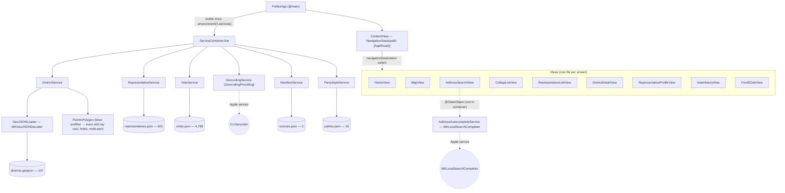
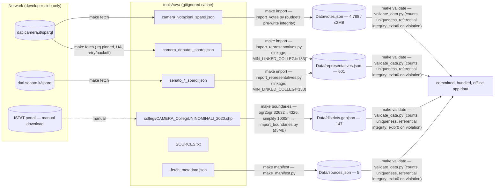

# Politica Engineering and Product History
## From v1.0.0 Sample Prototype to v2.0-prototype Real-Data Release

**Document type:** implementation history and engineering decision record (Document A of a three-document pack).
**Companion documents:** `POLITICA_V3_FACTUAL_BASELINE.md` (Document B), `POLITICA_HISTORY_GAPS_AND_CONFLICTS.md` (Document C).
**Compiled:** 2026-07-18, from the source material available in this Claude Project (see §3).
**Scope:** the two completed releases only. This document contains no V3 architecture.

---

# 1. Executive Summary

**Product purpose.** Politica is a native iOS app for exploring Italian parliamentary civic information: electoral colleges (*collegi*), members of Parliament, and roll-call votes, rendered on a MapKit map and in list form, entirely offline at runtime. It is an independent, unofficial prototype — not affiliated with the Camera dei Deputati, the Senato della Repubblica, ISTAT, or any other institution — and it states this in-app, verbatim, on its "Informazioni e fonti" screen. [E1/E2]

**Two-release evolution.** The project shipped twice:

1. **v1.0.0** (2026-07-16/17, documentation label; no git tag — see §2): a fully fictional/sample-data prototype that proved the architecture and UX. Five hand-drawn rectangular districts, 14 fictional representatives, 37 fictional vote records, `CLGeocoder` geocoding with a hardcoded five-city fallback, typed `NavigationStack` routing, a `ServiceContainer` dependency-injection pattern, and an interactive `Map` with tap-to-select polygons. No automated test coverage, no accessibility work, all Italian user-facing copy.
2. **v2.0-prototype** (annotated git tag, 2026-07-18, commit `72448dc`): a real-data and accessibility release built across 12 phase commits plus a documentation commit on branch `v2`, then fast-forwarded into `main`. It replaced every shipping dataset with real, officially sourced data — 147 ISTAT Camera collegi uninominali boundaries, 601 real representatives (400 deputies + 201 senators, XIX Legislature), a 147/147 deputy↔collegio linkage, and 12 curated Camera roll-call votes with 4,788 per-deputy positions — while keeping the app itself strictly offline. Around the data it added a schema-v2 provenance layer, tolerant enum decoding, a manifest-driven attribution screen, MapKit address autocomplete behind a protocol seam, a `MultiPolygon`-capable geometry engine with a bounding-box prefilter, a full searchable representative list, an accessible list alternative to the map, and 92 statically countable automated tests (see §17 for the count discrepancy against observed runs).

**Current maturity.** v2.0-prototype is a working, buildable, test-covered, offline civic-data prototype with real, provenance-labeled data and disclosed limitations. It is not a complete parliamentary record: 253 of 400 Camera deputies (plurinominale + estero) and all 201 senators are listed but not mapped to geography; votes cover 12 curated Camera roll calls (all from the sitting of 2026-07-15); Senato boundaries, Senato votes, real-time refresh, photos, attendance metrics, backend, and push notifications are all explicitly out of scope. Every one of these limitations is stated in the shipped `README.md` and, where user-facing, in-app. [E1/E2]

**What "local-first" means in this project.** The term has a precise, two-sided definition established in `CLAUDE.md` (v2) constraint #3 and verified against the shipped code:

- **The shipping app (`Politici/`) makes no network calls of its own.** No backend, no analytics, no remote image fetching, no runtime API calls. All data is bundled JSON/GeoJSON read once at launch. The only Apple-service network dependencies are `CLGeocoder` and `MKLocalSearchCompleter` (framework-level geocoding/search), each with an offline fallback path or graceful degradation.
- **The developer-side `tools/` pipeline is expected to use the network** — but only its `fetch` step, which queries the official Camera/Senato SPARQL endpoints and writes into a gitignored `tools/raw/` cache. Every other pipeline step (`import`, `boundaries`, `validate`, `manifest`) is fully offline and reproducible from that cache. The boundary between the two sides is a standing, written constraint: "Never blur this line by adding network calls to anything under `Politici/`." [E1/E2]

---

# 2. Canonical Naming and Version Map

## 2.1 Politica vs. Politici

| Identifier | Value | Evidence |
|---|---|---|
| User-facing display name | **Politica** (`INFOPLIST_KEY_CFBundleDisplayName = Politica`, Debug and Release) | [E1] set in commit `6d3b866`; a precisely scoped 2-line pbxproj diff |
| In-app identity | Politica / "Politica Italia" (README title) | [E1/E2] |
| Xcode project / target / scheme | **Politici** (all three) | [E1] present since the very first commit `3ab4e58` |
| Bundle identifier | `com.giuliocrp.Politici` | [E1] unchanged from `3ab4e58` through the `v2.0-prototype` tag |
| Test targets | `PoliticiTests`, `PoliticiUITests` | [E1] |

**The naming difference is intentional and the Xcode project was never renamed.** This was verified, not assumed: `git show 3ab4e58:Politici.xcodeproj/project.pbxproj` shows the same `PRODUCT_BUNDLE_IDENTIFIER` values as the tag, and the "display name rename" in the v1 boundary commit's message is confirmed to touch only the `CFBundleDisplayName` key. Never renaming project/target/scheme/bundle id is standing constraint #1 in `CLAUDE.md` and was held across all 17 commits. [E1]

## 2.2 Git tags and release boundaries

| Canonical release name | Git artifact | Commit | Alias |
|---|---|---|---|
| **v1.0.0** — original fictional/sample-data prototype | **No git tag exists.** Documentation-only label (used in `CHANGELOG.md`). Boundary commit identified from git structure. | `6d3b866fb85947506b2d03a0b289a6e791de3086` ("Complete Prototype v1: all phases, icon, display name rename") | Generation **V0** |
| **v2.0-prototype** — real-data and accessibility prototype | **Annotated tag** `v2.0-prototype` (tag object `a7593ad…`) | `72448dc22c69ef8dfdb5ae33376186e14450bdf7` ("docs(v2): README v2, data source documentation, changelog for v2.0-prototype") | Generation **V1** |

**Material finding, stated plainly:** `git tag --list` on the repository returns exactly one tag, `v2.0-prototype`. There is no `v1.0.0` tag, local or remote-tracking. The v1.0.0 boundary at `6d3b866` was established by the source-grounded evidence report from two independent, agreeing signals: the commit message content, and reflog evidence (`main@{1}: commit: Complete Prototype v1…` immediately preceding `main@{0}: merge v2: Fast-forward`; `v2@{14}: branch: Created from HEAD` at `6d3b866`). [E1] Every claim in this dossier scoped "at v1.0.0" therefore means "at commit `6d3b866`", with tag-level certainty for the commit identity but only documentation-level certainty for the *name*. Whether a `v1.0.0` tag was ever intended is an open question (Document C, Q2).

## 2.3 Optional V0/V1 aliases

Where a product-generation shorthand helps (e.g., "the V0 demo flow"), **V0 = repository release v1.0.0** and **V1 = repository release v2.0-prototype**. Every major heading and comparison in this dossier retains the canonical names so that a future V3 plan is unambiguous.

## 2.4 Why the canonical tag names remain authoritative

The repository's own documentation (`CHANGELOG.md`) and the annotated tag are the only durable, machine-checkable release identifiers this project has. Aliases are conversational conveniences; the tag `v2.0-prototype` and the commit `6d3b866` are what a fresh clone can verify. Any V3 work should reference these, and should resolve the missing-`v1.0.0`-tag question explicitly rather than inheriting the ambiguity (Document C, Q2).

---

# 3. Methodology and Evidence

## 3.1 Source material available to this dossier

This dossier was compiled exclusively from the files present in this Claude Project:

- `implementation-evidence-v1-v2.md` — a 1,500-line source-grounded forensic audit produced against the actual repository (via `git show` / `git ls-tree` / `git diff` / `git reflog`, never a checkout), with its own six-category confidence taxonomy. **This is the highest-priority source.**
- Committed repository documentation as captured in this Project: `README.md`, `CHANGELOG.md`, `CLAUDE.md`, `DATA_SOURCES.md`.
- Committed phase reports: `docs/v2/00-audit.md`, `01-real-data-import.md`, `02-post-import-audit.md`, `03-boundaries-audit.md`, `03-linkage-report.md`, `04-votes-import.md`, `a11y-checklist.md`.
- Planning documents (intent, not implementation): `politica-v2-master-plan.md`, `politica-v2-addendum-post-phase5.md`.
- The commissioning brief for this dossier itself, which carries a 26-item "known historical framework" of feedback loops. Where a framework item cannot be verified from any of the above, it is labeled as user-reported.

**Not available in this Project** (despite being listed as potentially available): the original v1 kickoff prompt, the original v1 Phase 1–4 prompts, a "Politica — Project Summary" document, and raw Claude Code phase-completion summaries. Their absence is itself recorded (Document C, G1). Consequences: several v1-era diagnostic narratives (framework items 1–3) and a few v2 details attributed to acquisition briefs can only be corroborated indirectly or labeled unverifiable.

## 3.2 Source-of-truth priority

When sources conflict, this dossier applies the commissioned hierarchy:

1. Source-grounded repository evidence from `implementation-evidence-v1-v2.md`;
2. Source code/data/tests at the relevant ref, where the evidence report quotes or measures them directly;
3. Git commit/tag/reflog history as reported there;
4. Committed `README.md`, `CHANGELOG.md`, `CLAUDE.md`, `DATA_SOURCES.md`, `docs/v2/*`;
5. Claude Code session narratives (preserved only where the evidence report restates them, since no raw completion summaries exist in this Project);
6. Original phase prompts and master plans (`politica-v2-master-plan.md`, the addendum).

**A prompt or plan proves only intent. It never proves implementation.** Deviations between plan and shipped state are treated as findings, not errors to smooth over (§7 per-phase "Deviations", §19, §20).

## 3.3 Confidence labels used throughout

This dossier reuses the evidence report's taxonomy and adds one label for the commissioning brief:

| Label | Meaning |
|---|---|
| **[E1]** | Verified from source/git — read directly from a cited commit's tree by the evidence report. |
| **[E2]** | Recorded in committed documentation (`docs/v2/*`, `README.md`, etc.), not independently re-derived from code. |
| **[E3]** | Reported by historical Claude Code session narrative not preserved in the repository (e.g., deleted scratch probe scripts). |
| **[E4]** | Directly executed and observed by the evidence report's author in its own session (e.g., `xcodebuild test` pass counts). |
| **[E5]** | Manually verified by the human user, per explicit attribution. |
| **[E6]** | *Non verificabile dal materiale disponibile* — cannot be established from anything available; stated with what evidence would resolve it. |
| **[U]** | Asserted only in the commissioning brief's 26-item framework; no independent corroboration found in the available material. |

Compound labels (e.g., [E2→E1]) mean a claim recorded in documentation was independently re-verified from source by the evidence report.

## 3.4 Limits of reconstruction

- Everything here is at most second-order: this dossier reads the evidence report and committed documents; it did not itself run `git`, build the app, or fetch any endpoint.
- v1 was built in essentially **one giant commit** (`6d3b866`), so intra-v1 phase history (the original "Phase 1–4" structure) is not recoverable from git; only its final state is. The v1 phase-by-phase narrative in §5 is therefore reconstructed from the final tree plus the commissioning brief, with labels.
- Diagnostic *processes* (probe scripts, failed intermediate runs) were scratch work, never committed; where a shipped code comment or committed doc records the *finding*, the finding is [E1]/[E2] while the process narrative is [E3] or [U].
- The `tools/raw/` cache is gitignored and was deliberately never opened by the evidence audit; claims about raw source data come only from what committed docs quote of it. [E2]

## 3.5 Plan versus implementation

Two planning artifacts exist. The **master plan** (`politica-v2-master-plan.md`) defined strategy, architecture, and phases 0–10 with ready-to-paste prompts. After Phase 5 deviated (SPARQL pipeline instead of manual raw downloads), the **addendum** (`politica-v2-addendum-post-phase5.md`) superseded the master plan's remaining phases and renumbered them 6–12. The shipped commit sequence matches the **addendum** numbering (Phases 0–11 plus a final documentation commit). Throughout this dossier, "the plan" for Phases 0–4 means the master plan; for Phases 6–11 it means the addendum (with the master plan's Phase 8/9/10 prompts reused as the addendum's 10/11/12 with stated deltas). §7 documents the mapping per phase.

---

# 4. Chronological Timeline

Seventeen commits total, one linear chain, zero merge commits anywhere in history (`git log --all --merges` returns nothing). Branch mechanics: `main` holds the three pre-/v1 commits; `v2` was created from `6d3b866` and received all 14 subsequent commits; `main` was then **fast-forwarded** to `v2`'s tip (no merge commit created), leaving `main`, `v2`, `origin/main`, and `origin/v2` all pointing at `72448dc`. The annotated tag `v2.0-prototype` points at that same commit. [E1]

| # | Date | Commit | Subject | Phase / boundary | Pre-state → intended → actual → verification → consequence |
|---|---|---|---|---|---|
| 1 | 2026-07-16 | `3ab4e58` | Initial Commit | pre-v1 | Empty project → stock Xcode "App" template → template as-is, including `Item.swift` (the SwiftData-style template model), flat `ContentView`/`PoliticiApp`, bundle id `com.giuliocrp.Politici`, `IPHONEOS_DEPLOYMENT_TARGET = 26.5` already present → [E1] via `git show` → all later naming/deployment-target facts trace here. |
| 2 | 2026-07-17 | `5d8e36a` | Add Xcode gitignore and clean up tracked artifacts | pre-v1 | Tracked build artifacts present → clean them, add `.gitignore` → Xcode/macOS/SPM patterns only (no `tools/raw/` yet — `tools/` doesn't exist until commit 9) → [E1] → hygienic baseline for v1 work. |
| 3 | 2026-07-17 | `6d3b866` | Complete Prototype v1: all phases, icon, display name rename | **v1.0.0 boundary (no tag)** | Template → the entire v1 feature set in one commit: Models/Services/Utilities/Views, 5 districts, 14 representatives, 37 votes, `README.md`, icon, `CFBundleDisplayName = Politica` (exactly a 2-line pbxproj addition) → [E1]; build/simulator verification per §5.14 → the complete v1 baseline that Phase 0 audits. `Item.swift` no longer present in this tree (see §20, item 2). |
| 4 | 2026-07-17 | `b0b6c77` | chore(v2): audit repo, create v2 branch, add CLAUDE.md guardrails | v2 Phase 0 | Clean v1 baseline → audit-only, no source changes → `docs/v2/00-audit.md` + `CLAUDE.md` v1; `v2` branch created from HEAD → [E1/E2] → standing constraints now persist across sessions; deployment-target 26.5 flagged (and never actioned — §22). |
| 5 | 2026-07-17 | `bdff254` | test(v2): bootstrap PoliticiTests with geometry, decoding, and service coverage | v2 Phase 1 | Template-only test files → real coverage before any data changes → geometry/decoding/service-lookup tests against the fictional data → [E1] → the safety net every later phase's "tests green" claim depends on. |
| 6 | 2026-07-17 | `d9a922f` | feat(v2): schema v2 — provenance, tolerant decoding, sources manifest | v2 Phase 2 | Plain v1 Codable models → provenance + tolerance + manifest infrastructure *before* any real data → `DataProvenance`, `TolerantStringEnum`, `SourcesManifest`/`ManifestService`, `Data/sources.json` (one honest sample-data entry) → [E1] → every later real-data phase has somewhere to record provenance from day one. |
| 7 | 2026-07-17 | `e6e5ffe` | feat(v2): add Informazioni e fonti attribution screen with disclaimers | v2 Phase 3 | No attribution UI → legal anchor before real data → `FontiEDatiView` + `.fontiEDati` route, manifest-driven cards, disclaimer, avvertenze → [E1] → Phase 6's audit later finds this "already exists and is wired", contradicting that task's drift assumption. |
| 8 | 2026-07-17 | `b92ffd8` | feat(v2): MKLocalSearchCompleter address autocomplete behind GeocodingProviding | v2 Phase 4 | Free-text + 5-city fallback only → autocomplete + protocol seam, fallback preserved → `AddressAutocompleteService`, `GeocodingProviding` protocol; CLGeocoder path unchanged → [E1] → the seam later serves as the documented migration point for any geocoding-API change (§11.9, §20 item 4). |
| 9 | 2026-07-17 | `f01dd15` | chore(v2): create tools directory and ignore tools/raw | v2 Phase 5 (setup) | No pipeline → scaffold + gitignore policy first → `tools/raw/` ignored before any cache exists → [E1] → guarantees raw dumps can never be committed by accident. |
| 10 | 2026-07-18 | `f6867eb` | feat(v2): import real representative data from Camera/Senato open data | v2 Phase 5 | 14 fictional representatives → real Camera+Senato import via a SPARQL fetch→cache→offline-import pipeline (a deviation from the plan's manual-download design, later ratified by the addendum) → 601 real records, `districtId` becomes `String?`, fictional originals preserved at `representatives.sample.json`; vote↔representative integrity test **weakened** with a disclosed comment → [E1/E2] → the bundle is now internally inconsistent (fictional `votes.json` orphaned), which becomes Phase 6's first job. |
| 11 | 2026-07-18 | `8b16be1` | fix(v2): reconcile bundle integrity, honest empty states, sigla styling, pipeline hygiene | v2 Phase 6 | Mixed real/fictional bundle, weakened test → status-audit-first reconciliation → fictional votes moved to `votes.sample.json`; `votes.json` ships as a **valid empty** collection; integrity test reinstated (vacuously true, disclosed); `Data/parties.json` + `PartyStyleService`; specified empty-state strings + provenance badge; demonstrative-boundaries caption; queries pinned to `.rq` files; retry/backoff; honest `retrievedAt`; `stableSourceId` given real meaning; Senato-201 semantics verified and documented; 52/52 tests passing at entry → [E1/E2] → a coherent, honest bundle for the boundaries phase to build on. |
| 12 | 2026-07-18 | `9841fea` | feat(v2): official ISTAT electoral-college boundaries with MultiPolygon engine | v2 Phase 7 | 5 fictional rectangles → real ISTAT Camera collegi uninominali → 147 features (EPSG:32632→4326, 1000 m simplification, ~1.10 MB), `MKGeoJSONDecoder`-based loader, `MKPolygon`/`MKMultiPolygon` + holes, bbox prefilter; the `MKMultiPolygon` decoding gap found and fixed within the phase (56/147 multi-part features would otherwise decode empty); rectangles preserved at `districts.sample.geojson` → [E1/E2; probe narrative E3] → real geography exists for Phase 8 to link against; `region: CU20_C1` knowingly shipped as-instructed with the mislabel disclosed. |
| 13 | 2026-07-18 | `2820bec` | feat(v2): link current deputies to ISTAT colleges; fix collegio circoscrizione metadata | v2 Phase 8 | Real geometry, no people attached; misleading `region` property → metadata truth fix + linkage → `region` removed, `circoscrizione`/`subCode` added (verified against all 147 rows and the official 28-circoscrizione list); existing `?collegio` found to be plurinominale granularity; `ocd:tipoElezione` + `dcterms:spatial` discovered via live introspection; normalized structural join → **147/147**, 2 by-election holders, 0 vacancies, 0 ambiguities; `MIN_LINKED_COLLEGI = 133` gate enforced in code → [E1/E2] → district pages come alive; `stableSourceId` numeric scheme becomes the votes join key. |
| 14 | 2026-07-18 | `6625944` | feat(v2): curated official Camera votes with per-deputy positions | v2 Phase 9 | Empty `votes.json` → curated real Camera roll calls → explore-first ontology work (generic procedural titles; atto labels; secret-ballot semantics), scope/budget config, 6000→5000 `maxPositionRecords` tuning after a refused 2.20 MB write → **12 parliamentary vote events / 4,788 per-deputy vote-position records / 1,834 KB**; dual referential-integrity enforcement; Foti/Bergamini cross-check against the official page; Fontana empty-state check → [E1/E2; live-page check E3 for the act, E2 for the recorded result] → the reinstated integrity test becomes genuinely non-vacuous with unchanged code. |
| 15 | 2026-07-18 | `8a1aa90` | feat(v2): UI completion for real data — search, party filters, initials avatars, and explainer copy | v2 Phase 10 | 601 records but only a 4-item Home preview → audit-first UI completion → party styling found **already complete** from Phase 6 (contrary to the brief's premise); the real gap was browsing: `RepresentativeListView` (searchable, 12 deduplicated party chips), `InitialsAvatar`, "Come funziona l'elezione" explainer, "Vedi tutti"/stat-card entry points → [E1; narrative E3 — no `docs/v2` report exists for this phase, a verified absence] → all 601 representatives reachable; sets up Phase 11's audit surface. |
| 16 | 2026-07-18 | `a084f3d` | feat(v2): accessibility pass — VoiceOver, Dynamic Type, non-color vote indicators, collegi list | v2 Phase 11 | Near-zero accessibility (one label app-wide) → audit-then-fix → `MapView` found to have **no VoiceOver path at all** (polygon tap-selection undiscoverable) ⇒ `CollegiListView` built as the necessary alternative; non-color `VoteBadge` (symbol + text + distinct Italian labels, testable on the model); combine/hide/hint sweep; the one `minimumScaleFactor` neutralized by hiding the avatar; five sub-44 pt controls fixed; Dynamic Type screenshots at M/XXXL (HomeView) → [E1/E2/E4] → disclosed remaining manual checks (VoiceOver walkthrough etc.) recorded as pending in the checklist. |
| 17 | 2026-07-18 | `72448dc` | docs(v2): README v2, data source documentation, changelog for v2.0-prototype | **v2.0-prototype tag target** | Docs describing the pre-v2 world → documentation truth pass → `README.md` rewritten to shipped reality, `docs/DATA_SOURCES.md` (cross-checked 1:1 against `sources.json`), `CHANGELOG.md`, refreshed `CLAUDE.md`; annotated tag created → [E1/E2] → the state the evidence audit itself verified as byte-identical to the working tree. |

Post-tag repository operations (fast-forward of `main`, pushes of both branches to `https://github.com/giuliocrp/politica.git`) are corroborated locally by all four refs pointing at `72448dc` [E1]; whether the repository is private, whether the tag was pushed, and whether a GitHub Release exists are **[E6]** from local evidence and **[U]** per the brief (see §20 item 26; Document C).

---

# 5. Release v1.0.0 — Original Prototype

All statements in this section describe the tree at commit `6d3b866` and are [E1] (read via `git show`/`git ls-tree` by the evidence report) unless labeled otherwise. Because v1 landed as a single commit, its internal phase structure ("Phase 1–4" of the original build) is not recoverable from git; where the commissioning brief describes intra-v1 events, they appear in §20 with [U]/[E6] labels.

## 5.1 Product scope

A demonstration of the full product loop on fictional data: find your district (by map tap or address), see its representatives, open a representative's profile, and read their vote history — in Italian, offline, with no accounts. The point of v1 was architectural and UX proof, not information value; the data was openly sample content.

## 5.2 Architecture

Single-module SwiftUI app, MVVM/service pattern:

- `@main struct PoliticiApp: App` constructs `ServiceContainer.live` **once** and injects it via `.environment(\.services, services)` on the root `WindowGroup` content.
- `ContentView` owns `@State private var path: [AppRoute]` and a single `NavigationStack(path:)` with one `.navigationDestination(for: AppRoute.self)` switch.
- Views read services back with `@Environment(\.services)` — never by reaching for a `.shared` singleton directly (the services are `.shared`-backed classes, but the access path is the environment).

This exact injection mechanism survived v2 **unchanged in structure**; v2 only added services to the container. [E1]

## 5.3 Project structure (32 files, excluding `.xcodeproj` internals)

```
Politici.xcodeproj/
Politici/
├── App/{PoliticiApp,ContentView}.swift
├── Assets.xcassets/ (AccentColor, AppIcon — icon.png, Contents.json)
├── Models/{District,Representative,Vote}.swift
├── Services/{ServiceContainer,GeoJSONLoader,DistrictService,
│             RepresentativeService,VoteService,GeocodingService}.swift
├── Utilities/{PointInPolygon,DateFormatting}.swift
├── Views/{AppRoute,HomeView,MapView,AddressSearchView,DistrictDetailView,
│          RepresentativeProfileView,VoteHistoryView}.swift
└── Data/{districts.geojson,representatives.json,votes.json}
PoliticiTests/PoliticiTests.swift
PoliticiUITests/{PoliticiUITests,PoliticiUITestsLaunchTests}.swift
README.md, icon.png, .gitignore
```

This tree matches `docs/v2/00-audit.md` and was independently re-verified via `git ls-tree`, not merely trusted. [E1]

## 5.4 Models

- `Chamber: String, Codable, CaseIterable, Hashable` — `.camera`/`.senato`; raw values unchanged through v2.
- `Coordinate: Codable, Hashable` — plain `{latitude, longitude}` with a `clLocationCoordinate2D` computed property. **Removed entirely in v2** (superseded by native `MKPolygon`/`CLLocationCoordinate2D`).
- `District: Identifiable, Hashable` with a custom `Decodable` that parses a GeoJSON `Feature` directly: `id`, `name`, `chamber`, `polygonRings: [[Coordinate]]`. By convention the first ring is exterior and further rings are holes — **but no v1 code ever reads a second ring**; `exteriorCoordinates` reads only `polygonRings.first`. A `centroid` computed property existed with **no call site found** in any v1 view (grep-verified) — why it existed is [E6], possibly a preview/debug leftover.
- `Representative: Codable, Identifiable, Hashable` — `id, name, chamber, districtId: String` (**non-optional**), `party, parliamentaryGroup, committees: [String], attendanceRate: Double` (**non-optional**), `photoName`. No provenance, electionType, stableSourceId, or sourceUrl — all v2 additions.
- `Vote: Identifiable, Hashable` — `VoteChoice` (favorevole/contrario/astenuto/assente; **no** `.sconosciuto`) and `VoteResult` (approvato/respinto; **no** `.sconosciuto`), both plain throwing `Codable`; `Vote` fields `id, representativeId, title, date, vote, result, sourceUrl: String?`, with a self-contained `yyyy-MM-dd` `DateFormatter`.

## 5.5 Sample data (exact, re-verified counts)

| File | Records | Content |
|---|---|---|
| `districts.geojson` | **5** | Camera: Roma Centro `IT-RM-C01`, Milano Centro `IT-MI-C01`, Napoli Nord `IT-NA-C01`; Senato: Torino Sud `IT-TO-S01`, Firenze Urban `IT-FI-S01` — one rectangle per city |
| `representatives.json` | **14** | Camera 9 / Senato 5; parties: Partito Democratico ×3, Fratelli d'Italia ×2, Movimento 5 Stelle ×2, Lega ×2, Forza Italia ×2, Alleanza Verdi e Sinistra ×2, Azione - Italia Viva ×1 |
| `votes.json` | **37** | `representativeId` values `REP001`–`REP014` |

The five cities match the `GeocodingService` fallback table 1:1 by name — deliberately, since that pairing *is* the mechanism the whole v1 demo flow was built around. [E1]

## 5.6 Services

- `ServiceContainer`: exactly 4 services — `DistrictService`, `RepresentativeService`, `VoteService`, `GeocodingService` — via `static let live` + an `EnvironmentKey`.
- `DistrictService.district(for:)`: **linear scan** over every district, calling `PointInPolygon.contains(coordinate, in: district.exteriorCoordinates)` — no bounding-box prefilter, exterior ring only, no holes.
- `RepresentativeService` / `VoteService`: `allX()`, `x(withId:)` / `x(for:)` — a shape that stayed stable from v1 through v2.
- `GeocodingService`: `CLGeocoder` first, then a **hardcoded five-city fallback table** (Roma/Milano/Napoli/Torino/Firenze coordinates), matched via `.folding(options: [.diacriticInsensitive, .caseInsensitive])` substring containment. This exact file — same table, same folding call — is **byte-comparably unchanged in v2**. [E1]
- `GeoJSONLoader`: hand-rolled `DistrictFeatureCollection: Decodable { let features: [District] }` decoded with plain `JSONDecoder` — no `MKGeoJSONDecoder`. A hand-rolled `MapBounds {northEast, southWest}` struct with its own bounding-math `region` property (replaced in v2 by an `MKMapRect`-backed version).

## 5.7 Point-in-polygon

`PointInPolygon.contains(_:in: [CLLocationCoordinate2D])`: even-odd ray casting over one flat ring. No holes, no MultiPolygon. Notably, this exact single-ring primitive was **retained unchanged** in v2 as the low-level function; v2 wrapped it rather than replacing it (§11).

## 5.8 Geocoding

Two layers: `CLGeocoder` (network-dependent Apple service) with the five-city offline table as fallback. There is no protocol seam in v1 — `GeocodingProviding` arrives in v2 Phase 4.

## 5.9 SwiftUI navigation

`AppRoute` (v1, **5 cases**): `.map`, `.addressSearch(initialQuery:)`, `.districtDetail(districtId:)`, `.representativeProfile(representativeId:)`, `.voteHistory(representativeId:)`. No `.fontiEDati`, `.collegiList`, or `.representativeList` — all v2. Typed, `Hashable` route values pushed onto a single stack.

## 5.10 Every screen

| Screen | v1 content |
|---|---|
| `HomeView` | Search field, map CTA, a 3-stat row, a **4-item** featured-representatives list. No explainer, no "Vedi tutti", no info toolbar button. |
| `MapView` | See §5.11. Legend with 2 colored dots (Camera/Senato); bottom `selectionCard` with "Vedi dettagli del collegio". |
| `AddressSearchView` | Free-text field + 5 sample-city quick-pick buttons → `GeocodingService.geocode(address:)` → `DistrictService.district(for:)`. **No autocomplete** (grep-verified absence of `MKLocalSearchCompleter`). |
| `DistrictDetailView` | District header + representative list; hosts `RepresentativeRow` and a **`PartyStyle` enum** — a hardcoded `switch` over the 7 *fictional* party display names. `PartyStyle` therefore **predates v2**; Phase 6 replaced it with data-derived `PartyStyleService` rather than introducing the concept. |
| `RepresentativeProfileView` | Profile header + votes preview. |
| `VoteHistoryView` | Full vote list per representative. |

## 5.11 MapKit interaction

`Map(position:)` with `MapPolygon(coordinates: district.exteriorCoordinates)` per district — the SwiftUI coordinate-array initializer, not `MKPolygon`. Selection: `MapReader` + `SpatialTapGesture` → tap point → coordinate → `district(for:)`. This tap-to-coordinate-to-point-in-polygon mechanism survives conceptually into v2; what changes later is the geometry behind it and — in Phase 11 — the discovery that this interaction has **no VoiceOver equivalent at all** (§16).

## 5.12 Italian UX

All user-facing strings Italian from v1 onward (later codified as `CLAUDE.md` constraint #2, which also fixes the complementary rule: repository documentation stays English). `DateFormatting` provides Italian-locale long/short/relative formatters, unchanged into v2.

## 5.13 Icon and display name

`icon.png` at the repo root and inside `AppIcon.appiconset/`, and `INFOPLIST_KEY_CFBundleDisplayName = Politica`, both landed in `6d3b866`. [E1] The commissioning brief attributes the icon to Canva; nothing in the available material records the icon's tool of origin — **[U]/[E6]**.

## 5.14 Documentation, build and simulator verification

`README.md` at v1 (108 lines): prototype framing, the 5 sample cities, the `CLGeocoder`+fallback flow, and a closing "Roadmap — Prototype v2" listing intentions (real parliamentary data APIs, full national shapefiles, SwiftData caching, push notifications, accessibility pass) — see §6.1 for which of those shipped, shipped differently, or were rejected. [E1]

Verification at v1 was **entirely manual**: per `docs/v2/00-audit.md`, "standalone compiled decode/logic harnesses run outside the test target, plus `xcodebuild` build checks and simulator screenshots." [E2] The specific v1 diagnostic loops the commissioning brief describes (the `DistrictFeatureCollection` compile-check failure; the CoreData/SQLite logging and white screen; the `xcode-select`/`DEVELOPER_DIR` discovery) are assessed individually in §20 items 1–3; only their end states are repository-verifiable.

## 5.15 Missing tests

`PoliticiTests.swift`: one Swift Testing `@Test func example()` with an **empty body**. `PoliticiUITests`: template `testExample()` (empty) and `testLaunchPerformance()` (launch-time only); `PoliticiUITestsLaunchTests`: template screenshot test. **No meaningful automated coverage of any kind existed at v1.0.0** — confirmed by reading every test file's full body, not inferred from names. [E1]

## 5.16 Limitations at v1.0.0 (reconstructed — v1 wrote no limitations list)

Entirely fictional data with no generating pipeline; 5-city geographic coverage; no offline geocoding beyond those 5 cities; no automated tests; no accessibility work; `PartyStyle` recognizes only its 7 fictional party names; `IPHONEOS_DEPLOYMENT_TARGET = 26.5` inherited from the template despite using no API newer than iOS 17. [E1, inferred from shipped code]

## 5.17 What v1 proved

That the product loop works end-to-end on-device and offline; that typed-route `NavigationStack` + environment-injected services is a workable, testable backbone (v2 kept it wholesale); that tap-to-district via ray casting is a viable interaction; and — negatively but usefully — that a data product without provenance, tests, or accessibility is only a demo. Every v2 phase is an answer to a specific v1 gap.

---

# 6. Transition from v1 to v2

## 6.1 Why real data changed the engineering problem

With fictional data, the app's only correctness criterion was "does it run." With real data, the criteria multiply: is every record traceable to an official source; is the license verified and displayed; are counts explainable (why 201 senators?); does absent data stay absent instead of being guessed; do external vocabularies crash the decoder; is the bundle internally consistent; can the whole dataset be regenerated reproducibly. The v1 README's roadmap imagined "real parliamentary data APIs" and "SwiftData caching"; the actual v2 answer rejected both framings (see below) because the real problem was *data trustworthiness*, not data plumbing.

Mapping the v1 roadmap to outcomes [E1 for the roadmap text; E1/E2 for outcomes]:

| v1 roadmap item | v2 outcome |
|---|---|
| Real parliamentary data APIs | Shipped **differently**: developer-side SPARQL fetch → gitignored cache → offline import → committed bundle; no runtime APIs. |
| Full national shapefiles | Shipped **partially by design**: Camera collegi uninominali only (147); Senato and plurinominale boundaries deferred. |
| SwiftData caching | **Rejected** for v2 (see §6.5). |
| Push notifications | **Deferred** explicitly as backend-dependent. |
| Accessibility pass | Shipped (Phase 11). |

## 6.2 Guardrails introduced

Phase 0 created `CLAUDE.md` with four standing constraints that held across all 14 v2 commits: (1) never rename project/target/scheme/bundle id; (2) Italian-only in-app strings (docs in English); (3) local-first shipping app, with the v2 refresh explicitly scoping the constraint to "the shipping app" and carving out `tools/`; (4) never present fictional data as real, never fabricate — absent values stay `null`, unknown vocabulary decodes to an explicit unknown case with a logged warning. The refreshed v2 `CLAUDE.md` additionally codified the working methodology the phases converged on: audit/verify before implementing; diagnose root cause before changing code *or* test; report findings including inconvenient ones. [E1/E2]

## 6.3 Honesty and provenance requirements

Concretely: `DataProvenance` on every model with an in-app rendering ("Fonte ufficiale"/"Dati dimostrativi"); the `*.sample.*` fixture convention keeping v1's fictional content available to tests but never to shipping views; the manifest-driven "Informazioni e fonti" screen so attribution can't drift from the data; the specified honest empty-state strings; and — repeatedly exercised — choosing an honest gap over a plausible invention (null `districtId`, empty `votes.json`, `attendanceRate` nil, no constructed deep links, preserved source truncation quirks).

## 6.4 Why direct runtime APIs were rejected

The master plan's core call, held throughout: the official portals are open-data platforms, not app backends. SPARQL from an iOS client means no SLA, schema churn, query complexity, and outages becoming app outages; live fetches can't be reviewed before users see them; and license verification would be attributing a moving target. An import pipeline absorbs all of that on the developer's machine, once, and leaves generated JSON in git where every data update is diffable and validatable. [Plan; ratified by the addendum and matched by the shipped architecture — E1]

## 6.5 Why SwiftData, a backend, and push stayed out

- **SwiftData:** ~601 people, a curated vote subset, one boundaries file — `Codable` + JSON decodes this well under a second and services already cache in memory; SwiftData would add migration complexity for zero user-visible benefit, and there is no user-generated state to persist. Revisit only if favorites/notes/sync arrive. [Plan; shipped state contains no SwiftData/CoreData — E1]
- **Backend / push:** push requires APNs plus a server that watches parliamentary activity — exactly the backend the product excludes. "There is no honest way to do push in a backend-free app"; faking it with local notifications from bundled data would undermine the credibility v2 exists to build. Deferred explicitly, and listed in the shipped README's v3 roadmap as backend-dependent. [Plan → README, E1/E2]

## 6.6 Testing-first strategy

The sequencing was deliberate: tests (Phase 1) and schema hardening (Phase 2) land **before** any real data, so regressions surface immediately and real data has a schema ready to receive it. The referential-integrity tests act as a data-QA gate on the shipping bundle — unusual for an app test suite, and exactly right for a data product. The one place this discipline bent (Phase 5's weakened vote-integrity test) was disclosed in code at the time and repaired two phases later through the documented weaken→vacuous→genuine cycle (§17.6, §20 item 8).

---

# 7. Release v2.0-prototype — Phase-by-Phase History

Phase numbering follows the **addendum** scheme (the shipped scheme). Each subsection uses the same twelve-field template. "Plan" for Phases 0–4 = master plan; for 6–11 = addendum (with the master plan's 8/9/10 prompts reused as 10/11/12 per the addendum's deltas). Phase 5 straddles the two.

## 7.0 Phase 0 — Audit and CLAUDE.md (`b0b6c77`, 2026-07-17)

- **Starting state/problem:** clean v1 baseline; no persistent guardrails for future Claude Code sessions; no verified inventory of what exists.
- **Original plan:** master plan Phase 0 — audit only, create branch `v2`, write `CLAUDE.md` with four standing constraints; modify no source.
- **Evidence discovered during implementation:** `IPHONEOS_DEPLOYMENT_TARGET = 26.5` project-wide despite an iOS-17-API codebase — flagged as a template default, not an intentional floor; both test targets exist but contain only boilerplate; `Data/*` are hand-written with no pipeline; an untracked `.claude/settings.local.json` present; v1 README's roadmap already sketches the v2 direction. [E2]
- **Actual implementation:** `docs/v2/00-audit.md` (frozen snapshot: tree, targets/schemes, deployment target, test status, data counts 5/14/37, surprises) + the original `CLAUDE.md`; `v2` branch created from `6d3b866`.
- **Important files/types/scripts:** `docs/v2/00-audit.md`, `CLAUDE.md`.
- **Data/schema impact:** none (audit-only, per acceptance criteria).
- **Testing and verification:** baseline `xcodebuild … build` with the `DEVELOPER_DIR` prefix (the command every later phase reuses verbatim). [E2]
- **Manual QA:** none required beyond the build.
- **Deviations from plan:** none identified.
- **Remaining limitation:** the deployment-target flag was recorded but never actioned in any later phase (§22).
- **Commit/tag evidence:** `b0b6c77`. [E1]
- **Lesson for future architecture:** an audit that *freezes* its snapshot (explicitly "not updated as v2 proceeds") gives later phases a fixed reference point; and a flagged-but-unowned issue (26.5) will survive twelve phases untouched unless someone is assigned to it.

## 7.1 Phase 1 — Test bootstrap (`bdff254`, 2026-07-17)

- **Starting state/problem:** zero meaningful automated coverage; every later phase's "tests green" claim would otherwise be vacuous.
- **Original plan:** master plan Phase 1 — add real `PoliticiTests` coverage (geometry, decoding, service lookups, date formatting) against the *current sample data*, ≥10 passing tests, no app-behavior change; prefer the `xcodeproj` gem for any pbxproj work, stop-and-ask rather than blind hand-editing.
- **Evidence discovered during implementation:** the test target already existed and wired cleanly (`@testable import Politici` resolves) — no pbxproj surgery needed. [E2, via 00-audit]
- **Actual implementation:** first real tests exercising app code: point-in-polygon geometry (inside/outside/edge/vertex/concave), bundled-data decoding with count assertions, service lookups (known coordinate → district; district → representatives; votes newest-first), Italian date formatting pinned to `it_IT`. A vote→representative referential-integrity check (`testEveryVoteReferencesAKnownRepresentative`) existed **from this bootstrap onward** — the fact that makes the Phase 5 weakening episode legible in git. [E1]
- **Important files/types/scripts:** `PoliticiTests/` (the seed of the eventual 11-file suite: `PointInPolygonTests`, `DecodingTests`, `ServiceLookupTests`, `DateFormattingTests`, …).
- **Data/schema impact:** none.
- **Testing and verification:** `xcodebuild … test` against a discovered simulator; build unchanged.
- **Manual QA:** launch once; Home renders as before (plan's check).
- **Deviations from plan:** none identified; the pbxproj-risk contingency was simply not needed.
- **Remaining limitation:** `PoliticiUITests` untouched — and it stays template-only through the final tag (§17.8).
- **Commit/tag evidence:** `bdff254`. [E1]
- **Lesson:** the safety net must exist before anything real changes; and putting a data-integrity assertion in the suite early is what later turns a data migration into a *visible* three-commit story instead of silent drift.

## 7.2 Phase 2 — Schema v2: provenance, tolerant decoding, manifest (`d9a922f`, 2026-07-17)

- **Starting state/problem:** models had nowhere to record where data came from, and any unexpected raw value would throw and blank an entire file on decode.
- **Original plan:** master plan Phase 2 — `DataProvenance` (.sample/.official, decode-default .sample), Representative gains `legislature`/`electionType`/`stableSourceId`/`sourceUrl` and optional `attendanceRate`, District gains `collegioType`/`region`/`sourceName`/`provenance`, tolerant vote/result enums, `Data/sources.json` with `schemaVersion: 2` and one honest sample entry, `SourcesManifest` + `ManifestService`; no view changes.
- **Evidence discovered during implementation:** a Swift-specific subtlety, documented in the shipped type's own comment: the compiler-synthesized `Decodable` for a raw-value enum takes precedence over a protocol extension's default witness, so conformers must call `decodeTolerant(from:)` explicitly from their own `init(from:)` — a bare `enum Foo: String, TolerantStringEnum` would silently keep throwing. [E1]
- **Actual implementation:** as planned. `DataProvenance: String, Codable, Hashable` with `displayName` ("Dati dimostrativi"/"Fonte ufficiale"); `TolerantStringEnum` protocol (`RawRepresentable where RawValue == String` + `static var unknownCase`, default `decodeTolerant` = `Self(rawValue:) ?? unknownCase`) reused by `CollegioType`, `ElectionType`, `VoteChoice`, `VoteResult`; every model's decoder defaults `provenance` to `.sample` when the key is absent (`decodeIfPresent(...) ?? .sample`), which is precisely what lets the pre-schema-v2 fixtures keep decoding unmodified; `SourcesManifest`/`DataSource` + `ManifestService` registered in the container (service #5).
- **Important files/types/scripts:** `Models/DataProvenance.swift`, `Models/TolerantDecoding.swift`, `Models/SourcesManifest.swift`, `Services/ManifestService.swift`, `Data/sources.json`.
- **Data/schema impact:** schema v2 established; sample files untouched in factual content.
- **Testing and verification:** decoding-default tests (sample → `.sample`), tolerant-decode fixture tests (unknown raw → `.sconosciuto`), shipping-bundle referential-integrity tests, manifest `schemaVersion == 2`. `SchemaV2Tests.swift` grows into the suite's largest file (23 methods at the tag). [E1]
- **Manual QA:** tap-through regression check per plan.
- **Deviations from plan:** none structural. Note that the planned `District.region` field is the one schema-v2 element later proven mislabeled and replaced (`circoscrizione`/`subCode`, Phase 8) — the plan's field name, not the mechanism, was the error.
- **Remaining limitation:** tolerance is per-enum-value, not per-record — a structurally malformed record still fails its file's decode (accepted design).
- **Commit/tag evidence:** `d9a922f`. [E1]
- **Lesson:** build the receiving schema *before* the data exists; and when a language feature can silently defeat a safety mechanism (synthesized `Decodable` vs. protocol default), write the reason into the type's doc comment so no future conformer re-trips it.

## 7.3 Phase 3 — Attribution screen (`e6e5ffe`, 2026-07-17)

- **Starting state/problem:** no legal/honesty anchor in the UI; the plan required it to exist *before* real data.
- **Original plan:** master plan Phase 3 — `FontiEDatiView` with exact Italian copy: app-identity paragraph (the unofficial-status disclaimer), per-source manifest cards ("Dati aggiornati al: …", conditional link), three avvertenza bullets (snapshot; "Dati dimostrativi" meaning; no logos/emblems), a licenses note; two Home entry points (toolbar info button + footer link); Dynamic-Type-friendly; no images or institutional emblems.
- **Evidence discovered during implementation:** none recorded (no phase report; low-risk UI phase).
- **Actual implementation:** as planned: `FontiEDatiView` rendering `ManifestService` entries live as `SourceCard`s, the disclaimer paragraph verbatim ("Politica è un prototipo indipendente a scopo informativo e dimostrativo. Non è affiliata a, né approvata da, la Camera dei Deputati, il Senato della Repubblica o altre istituzioni."), `BulletRow` avvertenze, the licenze note; new `.fontiEDati` route. [E1]
- **Important files/types/scripts:** `Views/FontiEDatiView.swift` (also home of the shared `BulletRow`), `AppRoute`.
- **Data/schema impact:** none (reads the Phase 2 manifest).
- **Testing and verification:** build + tests green; screen renders from the manifest, not hardcoded strings.
- **Manual QA:** open the screen; Dynamic Type scaling check (plan).
- **Deviations from plan:** none identified.
- **Remaining limitation:** at this point the manifest holds only the sample entry — the screen is an anchor awaiting real sources (by design).
- **Commit/tag evidence:** `e6e5ffe`. [E1]
- **Lesson:** landing the attribution surface before the data forces every later data phase to answer "what will this screen say about you?" — and it later saved Phase 6 from rebuilding something that already existed.

## 7.4 Phase 4 — Geocoding modernization (`b92ffd8`, 2026-07-17)

- **Starting state/problem:** address search was free-text-only against `CLGeocoder` + the 5-city table; no seam for testing or future API migration.
- **Original plan:** master plan Phase 4 — `protocol GeocodingProviding { func geocode(address:) async throws -> CLLocationCoordinate2D }`; `AddressAutocompleteService` wrapping `MKLocalSearchCompleter` (`.address` results, Italy-biased region ~(42.5, 12.5)); rework `AddressSearchView` for live suggestions with free-text fallback; Italian loading/no-result states; a code comment noting `CLGeocoder`'s expected deprecation direction and that `GeocodingProviding` is the migration seam (without raising the iOS 17 floor); fake-provider unit tests, completer manual-only.
- **Evidence discovered during implementation:** none recorded in committed docs. On the deprecation question specifically, the evidence audit later found **no** deprecation in the targeted SDK and could not verify any warning was ever observed in a build log — see §20 item 4 for the conflict with the commissioning brief's "iOS 26 reported CLGeocoder deprecation warnings". [E1/E6]
- **Actual implementation:** as planned. `GeocodingService` conforms to the new protocol with its fallback behavior untouched; `AddressAutocompleteService` is deliberately **not** in `ServiceContainer` — it is owned per-screen via `@StateObject` in `AddressSearchView`, because its `suggestions` are session-scoped mutable UI state, not an app-wide repository (rationale in its own doc comment). [E1]
- **Important files/types/scripts:** `Services/AddressAutocompleteService.swift`, `GeocodingProviding` (protocol), `Views/AddressSearchView.swift`.
- **Data/schema impact:** none.
- **Testing and verification:** `GeocodingProvidingTests.swift` (7 methods at tag) with canned-coordinate fakes: known city → its district; open-sea coordinate → nil.
- **Manual QA:** plan's per-city address checks and non-Italian-address error path.
- **Deviations from plan:** none identified in shipped behavior.
- **Remaining limitation:** the offline fallback is still only five cities — unchanged through the tag (§22); the completer itself has no automated coverage (accepted).
- **Commit/tag evidence:** `b92ffd8`. [E1]
- **Lesson:** a protocol seam pays twice — immediately (fake-provider tests) and prospectively (a contained landing zone for whatever Apple's geocoding API future turns out to be), independent of whether the anticipated deprecation ever materializes in a given SDK.

## 7.5 Phase 5 — Real representatives and the SPARQL pipeline (`f01dd15` setup + `f6867eb`, 2026-07-17/18)

- **Starting state/problem:** 14 fictional representatives; no pipeline of any kind; the master plan assumed manually downloaded raw exports.
- **Original plan:** master plan Phase 5 — offline `tools/` pipeline (Python 3, stdlib only) reading manually downloaded files from `tools/raw/` with a `SOURCES.txt`; one adapter per source; honesty rule: if inputs are missing, stop with instructions and write nothing; preserve fictional data as `representatives.sample.json`; `make import/validate/manifest/all`.
- **Evidence discovered during implementation:** the practically better source shape was the portals' **verified SPARQL endpoints** rather than bulk raw exports. The addendum records that the user curl-verified both endpoints manually first (the plan's "endpoint discovery is a manual research step") and the pipeline then automated them — a deviation the addendum's §1 formally ratifies as "an upgrade; adopt it as the standard". [Plan/addendum; endpoint URLs E1 via shipped scripts] The commissioning brief's fuller narrative (Camera's historical RDF people export proving too broad/relationally awkward; the Senato HTTP→HTTPS redirect and 403-without-descriptive-UA) is assessed in §20 items 5–6: the UA rejection is corroborated in committed docs and the shipped client's own comment (naming `Python-urllib` — i.e., the stdlib client, *not* `requests`); the redirect/403 specifics and the RDF-export detour are [U].
- **Actual implementation:** commit `f01dd15` first adds `tools/` and gitignores `tools/raw/` (policy before cache). Commit `f6867eb` ships the pipeline (`fetch_camera.py`, `fetch_senato.py`, `import_representatives.py`, `validate_data.py`, `make_manifest.py`, root `Makefile` with a network-touching `fetch` target added to the plan's offline set) and **601 real records** (400 Camera + 201 Senato, XIX Legislature, all `provenance: "official"`). Senato needs three queries (senatori/gruppi/commissioni) merged locally by senator URI. Documented judgment calls [E2, `01-real-data-import.md`]: `districtId` → `String?` (decoding `null` into non-optional `String` would throw away the whole array — the one required model change; `RepresentativeService`'s filter compiles unchanged via optional promotion); senators with a bound `fineMandato` excluded (raw query returned 208 incl. deceased members — presenting them as current would be factually wrong); `photoName` stays the SF Symbol fallback, real `?foto` URLs deliberately not carried (runtime image fetching would break local-first; rights unverified); `party` = Camera sigla / Senato full group name (Senato's gruppi query has no sigla at all); `parliamentaryGroup` preserved verbatim including Camera's truncation-at-`"("` quirk (reconstructing would be guessing); Camera names title-cased with the `MULE'` legacy-apostrophe quirk preserved as-is; `legislature = "XIX"` (what both queries are scoped to — stating it isn't fabrication); `electionType`/`attendanceRate`/`stableSourceId` left null/omitted (no non-invented meaning available yet). Known consequences accepted and disclosed: every sample district's representative list goes empty (graceful copy already exists); **`votes.json` becomes orphaned** (`REP001–014` vs. new `p######`/`s####` ids) and the vote→representative integrity test is **removed and replaced** by a weaker self-consistency check with an explicit re-add-later comment; `PartyStyle` recognizes no real value → gray fallback everywhere; the data-derived Home stat counts update automatically; the separate "Camere del Parlamento" card is a static hardcoded "2" as documented in §15.
- **Important files/types/scripts:** `tools/{fetch_camera,fetch_senato,import_representatives,validate_data,make_manifest}.py`, `Makefile`, `Data/representatives.json`, `Data/representatives.sample.json`, `Models/Representative.swift` (`districtId: String?`).
- **Data/schema impact:** representatives 14→601 real; `sources.json` 1→3 entries (Camera CC BY 4.0, Senato CC BY 3.0 added); districts/votes still fictional.
- **Testing and verification:** build + tests green with the disclosed weakening; `make validate` on the new file; counts asserted.
- **Manual QA:** plan's simulator check (real names visible; empty district lists expected).
- **Deviations from plan:** (a) SPARQL fetch/cache/import instead of manual downloads — ratified; (b) a new `fetch` Make target the plan didn't have; (c) the integrity test weakened — the addendum immediately classifies this as the one thing to repair first.
- **Remaining limitation (at phase end):** internally inconsistent bundle (real people + orphaned fictional votes + fictional geography with no user-facing label) — the entire agenda of Phase 6.
- **Commit/tag evidence:** `f01dd15`, `f6867eb`. [E1]
- **Lesson:** the fetch(network)/cache/import(offline) split is the load-bearing idea — it kept "local-first" true while making refresh a reproducible command; and a disclosed, commented test-weakening plus an immediate replanning loop is the honest failure mode when data outruns its dependents.

## 7.6 Phase 6 — Integrity reconciliation, empty states, party styling, pipeline hygiene (`8b16be1`, 2026-07-18)

- **Starting state/problem:** internally inconsistent bundle (real people, orphaned fictional votes, unlabeled fictional geography); a weakened integrity test; inline SPARQL query strings; `retrievedAt` stamped at manifest time rather than fetch time; an unexplained 201-senator count; real party values all falling to gray.
- **Original plan:** addendum Phase 6 — status audit first; move fictional votes to `votes.sample.json` and ship a valid empty `votes.json`; reinstate the integrity test at full strength; new shipping-data invariant tests (400/documented-Senato-count/unique non-empty ids and `stableSourceId`s/all-official provenance/non-empty groups); document Senato-count semantics from the raw cache; data-derived `Data/parties.json` + gray fallback; exact empty-state strings and a provenance badge; temporary "Confini dimostrativi — non corrispondono ai collegi reali." caption with a `REMOVE-IN-BOUNDARIES-PHASE` marker; attribution verified (build only if missing); pipeline hygiene (pinned `.rq` files, descriptive UA, timeout, retry/backoff, offline `make import`, fetch-time `retrievedAt`).
- **Evidence discovered during implementation** [E2, `02-post-import-audit.md` — written *before* changes, at `f6867eb`]: contrary to the task's drift assumption, `FontiEDatiView` **already existed and was wired** (both entry points), autocomplete already existed, Home's 601 stat was already dynamic, and `districtId` nil-safety was already consistent everywhere (grep + 52/52 tests passing). The genuine gaps: orphaned `votes.json`; `PartyStyle` recognizing zero real values; the *specific* required empty-state strings and provenance badge missing; no boundary-honesty caption; queries inline; no retry/backoff; `retrievedAt` conflation; `stableSourceId` null for all 601. Senato count answered by direct raw-cache inspection: **201 = 196 elettivo + 5 life senators (Cattaneo, Monti, Piano, Rubbia, Segre)**; 7 excluded with `fineMandato` bound (4 deceased, 2 resigned, plus Giorgio Napolitano — life senator by right, `fineMandato: 2023-09-22`, `tipoFineMandato: Deceduto`). Camera's 400 needed no scrutiny (exact constitutional size; `MINUS` on ended memberships). The 19 real party strings enumerated (10 Camera siglas incl. `MISTO`, 9 Senato full names incl. `Misto`) — with the explicit decision **not** to merge cross-chamber pairs into one colored entry (e.g., `FDI` vs. `Fratelli d'Italia` stay separate entries), since asserting sameness is an editorial judgment the phase didn't need; under-mapping is safe by the gray fallback.
- **Actual implementation:** all of the above gaps closed. `votes.json` ships as a valid, empty schema-v2 collection; fictional votes preserved at `votes.sample.json`; `testShippingVotesReferenceKnownRepresentatives` reinstated with a comment disclosing it is *"vacuously — but genuinely, not artificially — satisfied"* on the empty set [E1]; `Data/parties.json` (19 entries, one per exact shipping string, entry schema `{value, shortName, colorHex}` per the addendum's Phase 6 spec, each `colorHex` ≥4.5:1 contrast vs. white; the read-only fact-check of `git show 8b16be1:Politici/Data/parties.json` confirms the 19→12 shared `shortName` values — 7 shortNames each shared by exactly two entries — were already present in full at this commit, the file byte-identical between `8b16be1` and the tag [E1]) + `PartyStyleService` (dictionary lookup, gray fallback) replacing the v1 `PartyStyle` enum; empty-state strings "Nessun rappresentante collegato in questa versione del prototipo." / "Nessuna votazione disponibile in questa versione del prototipo."; provenance badge on `RepresentativeProfileView`; the boundaries caption added; `tools/queries/*.rq` pinning; `sparql_client.py` consolidation with `TIMEOUT_SECONDS = 60`, `MAX_ATTEMPTS = 3`, exponential backoff from 2 s, 4xx-never-retried, and the **descriptive** `USER_AGENT = "PoliticaApp-DataPipeline/1.0 (tools/fetch_*.py; civic-tech prototype, non-commercial)"` — an evolution from the earlier browser-like UA, honest rather than spoofed, with the client's own comment recording that `dati.senato.it` rejected the bare default `Python-urllib` UA [E1]; `.fetch_metadata.json` stamping so `retrievedAt` means fetch time; `stableSourceId` = the bare numeric segment of each source URI (e.g., `…/persona.rdf/p307394` → `"307394"`), verified collision-free across all 601 before becoming a test invariant.
- **Important files/types/scripts:** `Data/{votes,votes.sample,parties}.json`, `Models/PartyStyleEntry.swift`, `Services/PartyStyleService.swift` (container service #6), `tools/queries/*.rq`, `tools/sparql_client.py`, `docs/v2/02-post-import-audit.md`.
- **Data/schema impact:** votes 37 fictional → 0 (valid empty); parties.json born (19 entries); `stableSourceId` populated for 601/601.
- **Testing and verification:** integrity test reinstated (vacuous, disclosed); new invariant tests (counts, uniqueness, provenance, contrast — `PartyStyleServiceTests.testEveryEntryColorMeetsMinimumContrastAgainstWhite`); 52/52 passing at phase entry recorded, suite grows within the phase. [E1/E2]
- **Manual QA:** plan's walkthrough (captions, empty states, provenance badge, both licenses on the attribution screen).
- **Deviations from plan:** execution-level only — several planned build items became verify-only because Phases 3–4 had already delivered them; the plan's own "STATUS AUDIT FIRST" step is what caught this.
- **Remaining limitation:** geography still fictional (labeled as such); votes honestly empty pending Phase 9.
- **Commit/tag evidence:** `8b16be1`. [E1]
- **Lesson:** audit-before-implementing is not overhead — here it prevented duplicate screens and converted a "build X" task into "verify X, build the actual gaps"; and "an honestly empty dataset + a vacuously-true-but-disclosed test" is the correct intermediate state between orphaned data and real data.

## 7.7 Phase 7 — ISTAT boundaries and the MultiPolygon engine (`9841fea`, 2026-07-18)

- **Starting state/problem:** 5 labeled-fictional rectangles; a geometry stack that can't represent real coastlines (no MultiPolygon, no holes, hand-rolled parsing, linear-scan lookup).
- **Original plan:** addendum Phase 7 — inspect `tools/raw/collegi/` first and report actual layers/fields; `build_boundaries.sh` (reproject EPSG:4326, filter Camera uninominali, **mapshaper visvalingam keep-shapes** simplification, budget ≤~3 MB and ≤~1500 vertices/feature with numbers printed, schema-v2 properties incl. `chamber "camera"` and `region`); app-side `MKGeoJSONDecoder`→`MKPolygon` with `interiorPolygons`, MultiPolygon+holes ray casting, bbox prefilter, off-main-thread decode, cached polygons; remove the Phase 6 captions; new out-of-coverage copy; preserve rectangles as `districts.sample.geojson`; structural + hole/MultiPolygon + performance tests.
- **Evidence discovered during implementation** [E2, `03-boundaries-audit.md`, written pre-build]: prerequisites confirmed (GDAL 3.13.1 `ogr2ogr`; shapefile at the exact briefed path; `tools/raw/SOURCES.txt` ISTAT entry CC BY 4.0 — with a `RetrievedAt: 2025-07-18` value whose year conflicts with the shipped manifest's 2026-07-18, see Document C, C5; Senato/plurinominale sibling layers present but out of scope). Schema verified via `ogrinfo -so`: 147 features, EPSG:32632, `CU20_COD` Integer64, `CU20_DEN` String(150) (e.g., "Piemonte 1 - U01"), `CU20_C1` String(254). **Finding 1:** `CU20_C1` is *not* a region — it is literally `CU20_DEN`'s tail ("U01"/"U02"…), a within-plurinominale sequence suffix repeating nationwide; the brief's own "Likely" hedge anticipated this. Implemented literally as instructed (`region: CU20_C1`) since it's real non-fabricated data, flagged prominently, noted as not rendered anywhere. **Finding 2:** MultiPolygon is substantial, not edge-case — Sicilia/Sardegna test conversion: 15 of 16 features multi-part (Sardegna - U04: **124 parts**; Sardegna - U02: 33; Sicilia 1 - U06: 19; Sicilia 2 - U06: 18).
- **Actual implementation:** 147 real features shipped at ~**1.10 MB** (1,158,457 bytes at the tag), EPSG:32632→4326 via `ogr2ogr` with a **1000 m Douglas-Peucker `-simplify`** tolerance (per the script's own comment: calibrated to preserve every genuine multi-part island geometry under budget) — i.e., ogr2ogr/Douglas-Peucker, *not* the planned mapshaper/Visvalingam (§7.7 Deviations); `import_boundaries.py` applies the schema-v2 property transform with its own `MAX_OUTPUT_BYTES = 3 MB` gate, emits `chamber: "Camera"` **capitalized** to match the non-tolerant Swift `Chamber` enum exactly (the phase brief reportedly specified lowercase, which would have failed decode — brief wording [E3], shipped value and why it matters [E1]), and backs up the previous file to `districts.sample.geojson` only if that backup doesn't already exist (one-time preservation). App side: `GeoJSONLoader` rebuilt on `MKGeoJSONDecoder`; `District.polygons: [MKPolygon]` + computed `boundingMapRect`; `PointInPolygon` gains `contains(_:in: MKPolygon)` (holes-aware) and `contains(_:inAny:)` around the untouched v1 primitive; `DistrictService.district(for:)` gains the bbox prefilter. **The `MKMultiPolygon` gap:** the decoder represents GeoJSON `MultiPolygon` as one `MKMultiPolygon`, not flattened `MKPolygon` entries — the first in-phase implementation missed this and 56 of 147 districts decoded with empty geometry until the failing `DistrictBoundariesTests` plus standalone probes exposed it; the shipped `flatMap` unwrapping and an explanatory code comment are the durable fix (finding [E1]; probe narrative [E3]). Captions removed; coverage copy updated.
- **Important files/types/scripts:** `tools/build_boundaries.sh`, `tools/import_boundaries.py`, `Data/districts.geojson`, `Data/districts.sample.geojson`, `Services/GeoJSONLoader.swift`, `Utilities/PointInPolygon.swift`, `Services/DistrictService.swift`, `Views/MapView.swift`.
- **Data/schema impact:** districts 5 fictional → 147 real (56 MultiPolygon / 91 Polygon); `sources.json` gains the ISTAT entry; `region` present (mislabeled, disclosed).
- **Testing and verification:** `DistrictBoundariesTests` (structural checks on the shipping file; hand-built hole/disjoint-part fixtures; the 1,000-random-coordinate performance test — later documented as ~0.07 s), `PointInPolygonTests` extended. [E1/E2]
- **Manual QA:** plan's Sicily/Sardinia pan (islands visibly multi-part), cross-country taps, per-city address searches, ISTAT entry on the attribution screen.
- **Deviations from plan:** simplification tool/algorithm (ogr2ogr Douglas-Peucker vs. mapshaper Visvalingam); no per-feature vertex-count gate is evidenced, only the byte budget (Document C, C7); `region` knowingly shipped mislabeled with the correction deferred one phase.
- **Remaining limitation:** Camera uninominali only; `region`'s semantics wrong (fixed next phase); simplified geometry is display-grade, not survey-grade.
- **Commit/tag evidence:** `9841fea`. [E1]
- **Lesson:** verify a framework's *output shape* at runtime, not from documentation-reading — the MultiPolygon wrapper cost 56 silent losses until probed; and disclosing a knowingly-wrong-but-instructed field (`region`) is what let the next phase fix it cleanly instead of discovering it late.

## 7.8 Phase 8 — Representative-to-collegio linkage (`2820bec`, 2026-07-18)

- **Starting state/problem:** real geometry and real people, unconnected; district pages honest but empty; the boundaries metadata carries a field named `region` holding non-region values.
- **Original plan:** addendum Phase 8 — explore before coding (cached data + live introspection against `https://dati.camera.it/sparql`); if the graph carries college data, extend the fetch; normalization matcher (uppercase, strip accents/punctuation, region-scoped) with exact-after-normalization-or-listed-ambiguous; emit `districtId`/`electionType`; committed linkage report; **≥90% gate** (else stop and show the report); Interno-2022 as the documented fallback if the graph lacks the data.
- **Evidence discovered during implementation** [E2, `03-linkage-report.md`]: (A) The **full** `ogrinfo` field dump (OBJECTID, CU20_COD, CU20_DEN, CU20_C1, Shape_Leng, Shape_Area, POP_2011) proves **no dedicated circoscrizione field exists**; all 147 `CU20_DEN` values split cleanly as `"{circoscrizione} - {CU20_C1}"` with zero exceptions, and the 28 distinct prefixes are **exactly** the official D.Lgs. 177/2020 circoscrizione list (cross-checked against the Camera's own dossier) — so the parse rule is corroborated by the constitutional structure, not a dressed-up guess. (B) Inspecting the **cached** raw response first: all 55 distinct `?collegio` (`dc:coverage`) literals across 1,173 bindings use a `P0N` suffix or none (the 4 Estero macro-areas — EUROPA, AMERICA MERIDIONALE, AMERICA SETTENTRIONALE E CENTRALE, AFRICA ASIA OCEANIA ANTARTIDE — plus one bare "VALLE D'AOSTA"); i.e., the existing variable identifies only the **plurinominale** collegio (1–11 uninominali each) and cannot identify a majoritarian winner's seat. Live predicate enumeration then found the actual path: `?el ocd:tipoElezione ?tipo` ("maggioritario" / "maggioritario suppletiva" / "proporzionale") and `?el dcterms:spatial ?collegioUninominale` — bound **only** for maggioritario(-suppletiva) mandates, as `"{CIRCOSCRIZIONE} - U0N"` (confirmed absent for 15/15 sampled proporzionale mandates). A source quirk disclosed en route: by-election `dc:coverage` literals drop the P-suffix (bare "VENETO 2") — irrelevant to linkage since `dcterms:spatial` is the join key.
- **Actual implementation:** Part A metadata fix: `region` **removed**; `subCode` (= `CU20_C1`) and `circoscrizione` (= the `CU20_DEN` prefix) **added**, with a hard pipeline failure if any future `CU20_DEN` stops ending in `" - {CU20_C1}"`; `District.swift`/`GeoJSONLoader`/`validate_data.py`'s required-keys updated; output still 1,131 KB; `region` confirmed never rendered (grep before/after). Part B linkage: `camera_deputati.rq` extended with the two new predicates plus `MINUS { ?mandato ocd:endDate … }` (current mandate only — excludes a by-election's replaced predecessor; verified count-neutral: 414 XIX mandati, 14 ended, exactly 400 remain). Post-refetch `tipoElezione` split: 145 maggioritario + 2 suppletiva (**= 147, 0 vacant**) + 253 proporzionale (245 plurinominale + 8 estero). Matching ladder: rung (a) code join **not applicable** (no numeric code on either side); rung (b) **structural join used** — `normalize_circoscrizione` (uppercase, strip accents/punctuation, split on `"/"` keeping the Italian segment) joining on `(circoscrizione_norm, subCode)`; verified as a **complete exact bijection** (147/147/147, 0 unmatched either direction) *before* being written into `import_representatives.py`; rung (c) fallback implemented as a documented no-op, never reached. The one wrinkle: Valle d'Aosta's ISTAT bilingual `"Valle d'aosta/Vallée d'Aoste"` vs. SPARQL's Italian-only `"VALLE D'AOSTA"` — resolved by the `/`-split, verified collision-free across the other 27 (none contain `/`), and unambiguous anyway (one collegio on both sides). Classification rule: maggioritario(+suppletiva) → `electionType: "uninominale"` + matched `CU20_COD`; proporzionale+Estero-coverage → `"estero"`, null; proporzionale otherwise → `"plurinominale"`, null; **Senato untouched** (no boundaries exist — `districtId`/`electionType` stay null). By-election holders disclosed by name: Giulio Centenaro (50202, Veneto 2 - U02), Alberto Di Rubba (50201, Veneto 2 - U01). Quality gate `MIN_LINKED_COLLEGI = 133` (90%) enforced in code: below it, the script fails loudly and writes nothing. Import output recorded verbatim: "Collegamento collegio uninominale -> deputato: 147/147 … OK: 601 rappresentanti scritti…".
- **Important files/types/scripts:** `tools/queries/camera_deputati.rq`, `tools/import_representatives.py` (`normalize_circoscrizione`, `load_uninominale_index`, `UNINOMINALE_TIPO_ELEZIONE`, `ESTERO_COVERAGE_VALUES`, `MIN_LINKED_COLLEGI`), `tools/import_boundaries.py`, `Models/District.swift`, `docs/v2/03-linkage-report.md`.
- **Data/schema impact:** `districts.geojson` properties corrected (`region`→`circoscrizione`+`subCode`); `representatives.json`: 147 deputies gain a real `districtId`; Camera `electionType` fully populated (147/245/8).
- **Testing and verification:** linkage-integrity tests (every non-null `districtId` resolves; at most one uninominale deputy per college); Phase 6 invariants still green; the report's tables double as the verification record.
- **Manual QA:** addendum's external spot-check of 3 colleges' deputies — recorded as a required manual action; no committed artifact attests its performance ([E6] as to completion; see Document C).
- **Deviations from plan:** none needed — the report's own closing states rung (c) and the Interno fallback were never invoked; the genuine surprise (`?collegio`'s wrong granularity) was caught by exploring cached data *before* writing matching code, exactly as instructed.
- **Remaining limitation:** 253 Camera deputies and all senators remain geography-less by design; the linkage is only as current as the snapshot.
- **Commit/tag evidence:** `2820bec`. [E1]
- **Lesson:** a field's name — in a shapefile (`CU20_C1`) or a query (`?collegio`) — is a hypothesis, not a fact; explore-before-coding converted two would-be data corruptions into documented findings, and building the 90%-gate safety net even though this run hit 100% protects every future re-fetch.

## 7.9 Phase 9 — Curated official votes (`6625944`, 2026-07-18)

- **Starting state/problem:** `votes.json` honestly empty since Phase 6; the reinstated integrity test vacuous; no knowledge yet of how the Camera models votazioni.
- **Original plan:** addendum Phase 9 — explore the votazioni ontology first and record actual predicates + the raw position vocabulary; `votes_scope.json` (explicit URI list *or* "N most recent Assemblea electronic votes", N=25) with hard caps in code (max votes, max total position records, ≤~2 MB budget, printed counts); map deputy URIs to existing `stableSourceId`s (unmapped → dropped with a counted warning); raw vocabulary → tolerant enum with a documented table; `sourceUrl` only if genuinely present (never constructed); wrapping/dates/"Fonte" link UI polish; manifest scope note; the integrity test must stay green with real data.
- **Evidence discovered during implementation** [E2, `04-votes-import.md`]: live introspection from `SELECT DISTINCT ?p` over `ocd:votazione`, then full triple dumps of one real votazione (`vs19_047_005`) and one per-deputy `ocd:voto`. Vote-level: `dc:title`/`rdfs:label` is **always a generic procedural template** ("Votazione Articolo 1 PDL n. 0080", "Votazione finale ") — never the bill text; `dc:date` `yyyyMMdd`; `ocd:approvato` 0/1; `dc:relation` a real deep link to the official "scheda votazione" page (used verbatim as `sourceUrl`); flags `votazioneSegreta`/`votazioneFinale`/`richiestaFiducia` (the last has no schema slot — not carried); aggregate counts used only for sanity checks. **The real subject lives on the associated atto** (`ocd:rif_attoCamera` → `rdfs:label`), whose sample value exposed two purely mechanical source artifacts: an unescaped HTML entity (`&agrave;`) and a literal `^^…XMLSchema#string` suffix leaked into the string value itself — both cleaned deterministically (`html.unescape` + `ATTO_LABEL_ARTIFACT_RE`), explicitly framed as undoing an encoding glitch, not inventing content; `attoLabel` is OPTIONAL (organizational votes have none). Per-deputy `ocd:voto`: one entity per (votazione, deputato), 273–399 per vote; `ocd:rif_deputato` URIs end `d{numericId}_19` where `{numericId}` **is exactly `Representative.stableSourceId`** — a zero-ambiguity join with no extra lookup. Observed `dc:type` vocabulary: `Favorevole`, `Contrario`, `Astensione` (**noun→adjective**: mapped explicitly to `.astenuto`, since tolerant decode is exact-match, not fuzzy), `Non ha votato` (→ `.assente` as a **disclosed best fit** — the graph doesn't distinguish genuinely-absent from present-but-didn't-vote), and — **only on secret ballots** — the generic `Ha votato`. **Secret-ballot finding:** `votazioneSegreta 1` votes (98 of 37,959 XIX votazioni) *do* have per-deputy records, but a live `GROUP BY dc:type` on one gave `{"Ha votato": 286, "Astensione": 5, "Non ha votato": 108}` — no Favorevole/Contrario ever; secrecy is enforced at the data-publication level, so "electronic" scope = `votazioneSegreta 0`, and including secret votes would misrepresent inherent unattributability as unknown-by-omission.
- **Actual implementation:** `votes_scope.json` shipped as `{mode:"recent", n:25, voteUris:[], maxVotes:25, maxPositionRecords:5000}` (the explicit-URI mode supported and input-validated but unused). Two independent hard caps: `maxPositionRecords` — the one that binds (~399 positions/vote × 25 ≈ 9,975 records ≈ 4.6 MB, over budget); processing is newest-first and **stops at the first vote that would exceed the cap** (never bin-packed, keeping "the most recent K that fit" honestly explicable); and `MAX_OUTPUT_BYTES = 2 MiB` computed on real serialized bytes **before** writing — which correctly *refused* the first run's 2.20 MB output at `maxPositionRecords = 6000`, tuned to 5,000 after measurement. Shipped result, from the importer's own verbatim console output: **"OK: 4788 posizioni (12 votazioni) scritte … (1834 KB)"**, "votazioni incluse: 12/25 candidate", 13 excluded by budget (ids listed, starting `vs19_690_054`…). A characterization the pipeline reports rather than hides: all 12 included votes come from the single most recent sitting (2026-07-15), are all "Ordine del giorno" motions on the same bill (2822-A), all `Respinto`, and **none had an associated atto** — so every shipped title is the trimmed procedural `dc:title` alone (the combined-title path exists but was not exercised by shipped data). Mapping: `representativeId` = `p`+numericId against the **Camera** `stableSourceId` set (`dropped_unmapped_deputy = 0` this run); `id` = the source's own `ocd:voto` segment (e.g., `vd19_690_076_50204`); `provenance` always `"official"`; deterministic sort (date/id/representativeId desc) for reproducible diffs, with `VoteService` re-sorting at query time anyway. Referential integrity enforced **twice** (importer pre-write + `validate_data.py` re-check from the written files): "OK: integrità referenziale voti coerente — 4788 posizioni, 399 rappresentanti coinvolti". The one deputy with zero positions is verified deliberate, not a bug: **Lorenzo Fontana** (`p307591`), President of the Chamber, who by custom does not vote in ordinary roll calls — used as the live check of the Phase 6 empty-state copy. **Manual verification against the official record:** one vote (`RifVotazione=690_76`) and two deputies checked against the live official page — Tommaso Foti `Contrario`/`Contrario` ✓, Davide Bergamini `Favorevole`/`Favorevole` ✓, plus subject/date/outcome matching — an end-to-end pipeline check against an independent source (recorded result [E2]; the live fetch itself [E3], performed by the session, not by the human user). Disclosed limitation: no UI-tap automation existed, so screen-level rendering (wrapping, badge colors, the "Fonte" link opening) was **not** visually confirmed in this phase.
- **Important files/types/scripts:** `tools/fetch_camera_votes.py`, `tools/queries/camera_votazioni_{scope,dettaglio}.rq`, `tools/import_votes.py` (`RAW_VOTE_CHOICE`, `clean_atto_label`, `ATTO_LABEL_ARTIFACT_RE`, `build_title`, `MAX_OUTPUT_BYTES`), `tools/config/votes_scope.json`, `Data/votes.json`, `docs/v2/04-votes-import.md`.
- **Data/schema impact:** votes 0 → 4,788 real per-deputy positions across 12 events (1,878,366 bytes at the tag); `sources.json` gains the Camera-votazioni entry (5 entries total), with the manifest's scope note computed from the *actual* imported count, not the nominal 25.
- **Testing and verification:** the unchanged reinstated test becomes genuinely non-vacuous (comment-only change, [E1]); `testShippingVotesHaveNoUnmappedVoteOrResultVocabulary` guards the vocabulary table; dual integrity enforcement as above.
- **Manual QA:** Foti/Bergamini + Fontana checks as above; screen-level look explicitly deferred to a human.
- **Deviations from plan:** the master plan's hand-curated `votazioni_selezionate.json` design was superseded (addendum) by the rule-based scope; nominal 25 → shipped 12 by budget — a *disclosed* reduction, printed and manifested, matching the addendum's cap design.
- **Remaining limitation:** 12 of an unknown-but-larger set of qualifying votes; one-sitting/one-bill homogeneity; Camera only; the combined-title code path untested by shipped data.
- **Commit/tag evidence:** `6625944`. [E1]
- **Lesson:** ontology exploration before import turned three potential data corruptions (fake titles, secret-ballot "unknowns", vocabulary mismatches) into design decisions; a byte-budget check that *refuses to write* beats one that truncates; and "distinguish 'we don't know' from 'inherently unknowable'" is a schema-level principle, not a UI nicety.

## 7.10 Phase 10 — Full representative UI and explainer (`8a1aa90`, 2026-07-18)

- **Starting state/problem:** 601 real representatives in the bundle, but the only UI surface is Home's 4-item featured preview; the phase brief additionally assumed party styling still needed building.
- **Original plan:** master plan Phase 8 reused as addendum Phase 10 with a prepended instruction: *"AUDIT FIRST: a 601-representative display already exists somewhere on Home — inspect it before creating RepresentativesListView; extend rather than duplicate"*, and amendments: sigla mapping and empty states are DONE (Phase 6); this phase polishes colors/shortNames, adds search + party filter chips, initials avatars, and the explainer, whose text must state precisely what is mapped.
- **Evidence discovered during implementation:** the audit found party styling **already complete** from Phase 6 — `parties.json` with full 19-value coverage and verified contrast — contradicting the brief's premise; and the genuinely missing product capability was any route to browse all 601 (Home's preview was it). **Caveat:** this phase has **no `docs/v2/*.md` report** — a verified-from-git absence (every other phase from 5 onward has one); everything beyond the commit's own diff is [E3].
- **Actual implementation** [state at tag E1]: `RepresentativeListView` — `.searchable` name filtering via the project's standard diacritic/case-insensitive folding (locale `.italian`); a horizontal row of `PartyFilterChip`s built from **distinct `shortName`s, not raw `party` values** — **12 chips** from the 19 party strings (per `parties.json`'s 19→12 shortName mapping), so a Camera-sigla/Senato-full-name pair like `"FDI"`/`"Fratelli d'Italia"` (both → `"FdI"`) filters as one chip instead of appearing twice. `InitialsAvatar` (in `DistrictDetailView.swift` beside `RepresentativeRow`): a party-colored `Circle` overlaid with `Initials.from(name)` — two letters, first+last token — 52 pt in rows, 96 pt in the profile header; no image asset, no network. Home gains the "Come funziona l'elezione" `DisclosureGroup` with three `BulletRow`s stating, in-app and verbatim in intent: 147 Camera deputies are uninominale-elected and mapped to a real collegio; other Camera deputies (plurinominale/estero) are listed but not mapped; senators are listed but Senato boundaries aren't in this prototype. New `.representativeList` route; Home's "Vedi tutti" link and the "Rappresentanti" stat card route to it.
- **Important files/types/scripts:** `Views/RepresentativeListView.swift`, `Utilities/Initials.swift`, `Utilities/ColorHex.swift`, `InitialsAvatar`, `HomeView.swift`, `AppRoute`.
- **Data/schema impact:** none (UI over existing data).
- **Testing and verification:** `InitialsTests.swift` (8 methods) added; existing suites green.
- **Manual QA:** plan's checks (search a surname; filter by two parties; open colleges with and without a linked representative).
- **Deviations from plan:** the plan's own premise (styling to build) was wrong and the audit-first instruction caught it — the deviation *is* the compliance. Minor placement note: the explainer landed on **Home**, while the original master-plan prompt had proposed `DistrictDetailView`; the addendum delta did not re-pin the location. [E1 for placement]
- **Remaining limitation:** no committed design note for this phase (a self-documentation gap, §22); the formerly open micro-question on when the shared shortNames converged is resolved — the read-only fact-check of `git show 8b16be1:Politici/Data/parties.json` shows the 19→12 shortName mapping already present in full at Phase 6, the file byte-identical between `8b16be1` and the tag (Document C, C10 — resolved) [E1].
- **Commit/tag evidence:** `8a1aa90`. [E1]
- **Lesson:** "audit before implementing" works even when the auditor wrote the earlier phases — a dataset being imported does not mean it is browsable, and the UI layer needs its own gap analysis separate from the data layer.

## 7.11 Phase 11 — Accessibility (`a084f3d`, 2026-07-18)

- **Starting state/problem:** effectively zero accessibility support — the pre-phase grep found exactly **one** `.accessibilityLabel` in the entire app (Home's info toolbar button).
- **Original plan:** master plan Phase 9 reused as addendum Phase 11 with deltas: label the provenance badges and new empty-state strings; `CollegiListView` must now be `.searchable` (147 real colleges); verify party colors + badge palette pass 4.5:1 together. Steps: non-color vote badges with pinned Italian labels; VoiceOver labels/hints/combining with decorative elements hidden; the list alternative to the map with entry points from Map and Home; Dynamic Type audit at accessibility sizes preferring reflow over `minimumScaleFactor`; ≥44 pt hit targets; Reduce Motion; a committed checklist.
- **Evidence discovered during implementation** [E2, `a11y-checklist.md`, audit table]: per-view audit showing "None" nearly everywhere; **the finding**: `MapView` — district selection is a raw `SpatialTapGesture` on `MapReader`/`Map`, and MapKit polygon overlays rendered this way are **not exposed as discoverable/selectable VoiceOver elements at all** — "the single biggest gap in the app and the reason CollegiListView exists". Also: no `CollegiListView` or map alternative existed (grep-confirmed); **no custom animations anywhere** (so nothing to gate behind Reduce Motion — noted rather than invented); Dynamic Type grep found exactly one risk — `InitialsAvatar`'s `.minimumScaleFactor(0.7)` — and zero `lineLimit` truncation.
- **Actual implementation:** (1) `VoteBadge` non-color-only: SF Symbol + the existing Italian word via `Label`, plus a distinct `accessibilityLabel` per case — checkmark/"Voto favorevole", xmark/"Voto contrario", minus/"Astenuto", slash.circle/"Assente", questionmark/"Esito non disponibile" — with the mapping **moved onto `VoteChoice` itself** (`symbolName`/`accessibilityLabel` computed properties) for testability; the separate `VoteResult` esito icon, already paired with literal text, hidden as redundant for VoiceOver. (2) VoiceOver sweep: `RepresentativeRow`, `StatCard`, the District/Profile headers combined via `.accessibilityElement(children: .combine)`; avatar + chevron + legend dots + decorative icons hidden; hint "Apre il profilo del rappresentante" inherited by every wrapping Button; `PartyFilterChip` gains "Filtra per …" + `.isSelected` trait; autocomplete rows combined; icon-only controls labeled. **The one deliberate non-combine:** `VoteRow` keeps its "Fonte" `Link` **outside** the combined block — combining a container with a nested interactive control would remove that control from VoiceOver swipe navigation entirely, not just merge its text (reasoning stated in the view's own comment); the link gets label "Fonte ufficiale" + a leaves-the-app hint. (3) `CollegiListView`: `.searchable` list of all 147 shipping collegi (name or circoscrizione, standard folding), each `CollegioRow` → the same `.districtDetail` route the map tap uses; entry points: a **new** toolbar on `MapView` ("Sfoglia come elenco" — the map had no toolbar before) and Home's "Collegi campione" stat card made tappable; new `.collegiList` route. (4) Dynamic Type: the `minimumScaleFactor` resolved not by removal but by `.accessibilityHidden(true)` on `InitialsAvatar` at every call site — the real name is always unscaled text in the same row/header, so no information is lost at any size; verified visually via the documented `-UIPreferredContentSizeCategoryName` launch-argument override at `AccessibilityM` and `AccessibilityXXXL` (screenshots, [E4]) — Home's stats row wraps/hyphenates correctly, nothing clipped. (5) Hit targets: five sub-44 pt custom controls (`PartyFilterChip` ~31 pt; the search-field trailing icon button; Home's footer link ~24 pt; the "Fonte"/"Apri la fonte" links; the sample-city quick buttons) brought to ≥44 pt — four of the five via `.frame(minHeight: 44).contentShape(Rectangle())`, Home's footer link via added bottom padding; stock system button styles left as-is (already HIG-sized). (6) Tests: `VoteChoiceAccessibilityTests` asserts every case's symbol and label are non-empty and mutually distinct (catching a silent color-only regression) and pins the exact Italian copy.
- **Important files/types/scripts:** `Views/CollegiListView.swift`, `Views/VoteHistoryView.swift` (`VoteRow`/`VoteBadge`), `Models/Vote.swift` (`VoteChoice.symbolName/.accessibilityLabel`), `PoliticiTests/VoteChoiceAccessibilityTests.swift`, `docs/v2/a11y-checklist.md`.
- **Data/schema impact:** none.
- **Testing and verification:** suite green incl. the new accessibility-invariant tests; Dynamic Type screenshots as above.
- **Manual QA:** the checklist **discloses** what could not be done in-environment — VoiceOver was never actually switched on and swept (no gesture automation existed); Dynamic Type screenshots cover HomeView only at two sizes; hit targets were computed from layout code, not measured with Accessibility Inspector — and lists **five specific pending human checks** (full VoiceOver walkthroughs of both flows; an Accessibility Inspector audit of all 9 screens; a max-size re-walk; a Reduce Motion toggle; a rotor Links check on VoteHistory/FontiEDati). The commissioning brief states the user later completed these and found them working — **[E5 as user-reported; the repository records them only as pending]** (Document C, C12).
- **Deviations from plan:** none substantive; Reduce Motion resolved as a verified no-op rather than invented work.
- **Remaining limitation:** the map control itself remains inherently non-VoiceOver-navigable (the list is the alternative *path*, not a fix to the control); everything above is API-level implementation + code review + two screenshots, pending the human pass.
- **Commit/tag evidence:** `a084f3d`. [E1]
- **Lesson:** an interaction whose only path is visual/gestural is an architectural finding, not a labeling task — the correct fix was a new route and screen; and an accessibility checklist that states what was *not* verified is worth more to V3 than one that claims completeness.

## 7.12 Final documentation, merge, tag, and release (`72448dc`, 2026-07-18)

- **Starting state/problem:** README still described the pre-v2 world ("5 sample districts", a roadmap of things now built); no canonical source reference; no changelog; `CLAUDE.md` predating the conventions v2 converged on.
- **Original plan:** master plan Phase 10 reused as addendum Phase 12 with deltas — README to shipped truth incl. the SPARQL fetch/import split and one-command refresh; `docs/DATA_SOURCES.md` per source with license-as-verified and the 5-step refresh procedure; `CHANGELOG.md` per phase; a cross-check that the in-app manifest and DATA_SOURCES.md agree (flag, don't silently edit); refresh `CLAUDE.md`; final build+tests; commit; **create the annotated tag locally and do NOT push** — hand the push commands to the user.
- **Evidence discovered during implementation:** the cross-check ran clean — all 5 manifest entries match `docs/DATA_SOURCES.md` exactly (id/name/url/license/retrievedAt), recorded in that file's own "Cross-check" section and later independently re-confirmed by the evidence audit. [E2→E1]
- **Actual implementation:** `README.md` rewritten to the shipped v2 state (features, architecture, pipeline, exact build/test commands, the full Known Limitations list, the v3 roadmap with push explicitly backend-deferred and SwiftData explicitly conditional); `docs/DATA_SOURCES.md` created as the browsable, transformation-annotated mirror of `sources.json` with the 5-step refresh procedure and a maintenance rule (it is not auto-generated — re-verify after any `make manifest`); `CHANGELOG.md` created (Keep-a-Changelog spirit, per-phase entries with commit hashes, plus the v1.0.0 documentation-label entry); `CLAUDE.md` refreshed with the v2 constraint scoping, the `*.sample.*` convention, and the codified working methodology; annotated tag `v2.0-prototype` created on this commit.
- **Important files/types/scripts:** `README.md`, `docs/DATA_SOURCES.md`, `CHANGELOG.md`, `CLAUDE.md`.
- **Data/schema impact:** none.
- **Testing and verification:** final build+test pass per plan; the evidence audit later confirmed the working tree byte-identical to the tag (`git diff v2.0-prototype -- .` → empty). [E1]
- **Manual QA:** plan's "follow the README on a fresh clone" check — no committed artifact attests it ([E6] as to performance).
- **Deviations from plan:** one, verified: the prompt requested a **separate release-note file**; the repository contains **no `docs/releases/v2.0-prototype.md`** — only `CHANGELOG.md` (a verified-from-git absence). The brief states the GitHub Release description was then assembled manually outside the repo — [U]/[E6]. (§20 item 24; Document C.)
- **Remaining limitation:** repository-side history ends at the tag; everything after (push of the tag, GitHub Release, repo visibility) is outside local git evidence.
- **Commit/tag evidence:** `72448dc`; tag object `a7593ad…` → `72448dc22c69ef8dfdb5ae33376186e14450bdf7`. Subsequent operations corroborated locally: `main` fast-forwarded to `v2`'s tip (reflog), all four branch refs at `72448dc`. [E1]
- **Lesson:** documentation that *re-verifies* its claims (the manifest cross-check; commands checked against the Makefile) is the only kind a later audit can lean on; and a missing planned artifact honestly recorded (the release-notes file) beats a claimed one.

---

# 8. Final v2 Runtime Architecture

All facts [E1] at `v2.0-prototype` unless noted.

## 8.1 App entry point

`@main struct PoliticiApp: App` constructs `ServiceContainer.live` exactly once and injects it with `.environment(\.services, services)` on the root `WindowGroup` content. `ContentView` owns the single `NavigationStack(path: $path)` over `[AppRoute]` with one `.navigationDestination(for: AppRoute.self)` switch dispatching to screens. Unchanged in structure since v1.

## 8.2 ServiceContainer and dependency injection

Six services at the tag (v1's four plus two v2 additions):

| Service | Loads / provides | Since |
|---|---|---|
| `DistrictService` | `districts.geojson`; `district(for:)` with bbox prefilter; `allDistricts()` | v1 (prefilter v2 P7) |
| `RepresentativeService` | `representatives.json`; lookups by id / by `districtId` | v1 |
| `VoteService` | `votes.json`; `votes(for:)` newest-first | v1 |
| `GeocodingService` | `CLGeocoder` + five-city offline fallback; conforms to `GeocodingProviding` | v1 (protocol v2 P4) |
| `ManifestService` | `sources.json` → `SourcesManifest`/`DataSource` | v2 P2 |
| `PartyStyleService` | `parties.json`; `color(for:)` / `shortName(for:)`, gray fallback | v2 P6 |

Services are `.shared`-singleton-backed classes, but views access them only via `@Environment(\.services)` — the codified convention. One deliberate outlier: `AddressAutocompleteService` is **not** in the container; it is a per-screen `@StateObject` in `AddressSearchView`, because its suggestion list is session-scoped mutable UI state, not an app-wide repository (documented in its own comment).

## 8.3 Model / service / view boundaries

- **Models** (`Politici/Models/`): pure `Codable` domain types plus the schema-v2 infrastructure (`DataProvenance`, `TolerantStringEnum`, `SourcesManifest`, `PartyStyleEntry`). Accessibility-relevant presentation constants live on the model where testability demands it (`VoteChoice.symbolName`/`.accessibilityLabel`).
- **Services** (`Services/`): bundle loading, lookups, geocoding. No view imports; no networking anywhere under `Politici/`.
- **Utilities** (`Utilities/`): pure stateless helpers — `PointInPolygon`, `DateFormatting`, `Initials`, `ColorHex`.
- **Views** (`Views/`): one file per screen; small components shared by exactly two related screens live beside their primary consumer (`RepresentativeRow`/`InitialsAvatar` in `DistrictDetailView.swift`; `VoteRow`/`VoteBadge` in `VoteHistoryView.swift`; `BulletRow` in `FontiEDatiView.swift`) — a written convention with a written escape hatch for 3+ consumers.

## 8.4 Typed navigation routes

`AppRoute` at the tag — 8 cases: `.map`, `.addressSearch(initialQuery:)`, `.districtDetail(districtId:)`, `.collegiList` (P11), `.representativeList` (P10), `.representativeProfile(representativeId:)`, `.voteHistory(representativeId:)`, `.fontiEDati` (P3).

## 8.5 Local bundle loading and the runtime network boundary

Five generated data files are bundled and read once at launch: `districts.geojson` (~1.10 MB), `representatives.json` (~429 KB), `votes.json` (~1.79 MB), `parties.json`, `sources.json` — plus the three `*.sample.*` fixtures that no shipping view or service ever loads by default. The app makes **no custom network calls**; the only network-capable code paths are Apple framework services (`CLGeocoder`, `MKLocalSearchCompleter`), each degrading gracefully offline (five-city table; no suggestions).

## 8.6 Error / empty-state strategy

Fail-soft with honest copy rather than crash or fabrication: tolerant enum decoding (`.sconosciuto` + rendering for it); optional fields rendered conditionally (attendance badge hidden when nil; "Fonte" link only when a real `sourceUrl` exists); specified Italian empty states ("Nessun rappresentante collegato in questa versione del prototipo.", "Nessuna votazione disponibile in questa versione del prototipo.", "Non è stato possibile associare l'indirizzo a un collegio elettorale."); a provenance badge on profiles; the attribution screen as the standing disclosure surface.

## 8.7 Architecture diagram



Plain-text equivalent:

```
PoliticiApp (@main)
 ├── ServiceContainer.live ──injected via .environment(\.services)──▶ every view
 │     ├── DistrictService ──▶ GeoJSONLoader (MKGeoJSONDecoder) ──▶ districts.geojson (147)
 │     │        └── PointInPolygon: bboxprefilter → even-odd ray cast (holes, multi-part)
 │     ├── RepresentativeService ──▶ representatives.json (601)
 │     ├── VoteService ──▶ votes.json (4,788 positions / 12 events)
 │     ├── GeocodingService (GeocodingProviding) ──▶ CLGeocoder ▸ 5-city offline fallback
 │     ├── ManifestService ──▶ sources.json (5 entries)
 │     └── PartyStyleService ──▶ parties.json (19 entries → 12 shortNames)
 └── ContentView: NavigationStack over [AppRoute] (8 typed cases)
       ├── HomeView ─▶ .map | .addressSearch | .collegiList | .representativeList | .fontiEDati
       ├── MapView (tap→coordinate→district(for:)) ─▶ .districtDetail   [toolbar → .collegiList]
       ├── AddressSearchView (+ @StateObject AddressAutocompleteService) ─▶ .districtDetail
       ├── CollegiListView ─▶ .districtDetail
       ├── RepresentativeListView ─▶ .representativeProfile
       ├── DistrictDetailView ─▶ .representativeProfile
       ├── RepresentativeProfileView ─▶ .voteHistory
       ├── VoteHistoryView ("Fonte" Link → external Safari)
       └── FontiEDatiView ("Apri la fonte" Link → external Safari)
Runtime network: NONE app-owned. Apple services only (CLGeocoder,
MKLocalSearchCompleter), each with offline degradation.
```

---

# 9. Developer-Side Data Architecture

Source: `Makefile` and `tools/` at the tag. [E1]

## 9.1 The pipeline, step by step

- **SPARQL fetch** (`make fetch` — the *only* network-touching target; its own comment: "Requires network access. Writes only under tools/raw/."): `fetch_camera.py` runs `queries/camera_deputati.rq` against `https://dati.camera.it/sparql` → `tools/raw/camera_deputati_sparql.json`; `fetch_senato.py` runs three queries (senatori/gruppi/commissioni) against `https://dati.senato.it/sparql`, merged locally by senator URI; `fetch_camera_votes.py` runs the scope query then the detail query. On success, `tools/raw/.fetch_metadata.json` is stamped per source with the fetch date.
- **Raw cache** (`tools/raw/`): gitignored since `f01dd15` (confirmed via `git status --porcelain --ignored`); regenerable, never committed, never opened by the evidence audit. Also holds the manually downloaded ISTAT shapefile under `tools/raw/collegi/…` and the human-maintained `SOURCES.txt`.
- **Offline import** (`make import`): `import_representatives.py` merges the Camera/Senato caches into `representatives.json` and owns the linkage logic; `import_votes.py` merges the votes cache into `votes.json` under the scope/budget config. Both fail loudly if the cache is missing — they never fall back to fetching.
- **Boundary generation** (`make boundaries`): `build_boundaries.sh` (`ogr2ogr` reproject + simplify from the local shapefile — it does **not** download it) → `import_boundaries.py` (schema-v2 property transform, one-time sample backup, 3 MB gate).
- **Validation** (`make validate`): `validate_data.py` re-checks structure + referential integrity from the written files, from scratch — `EXPECTED_CAMERA_REPRESENTATIVE_COUNT = 400`, `EXPECTED_SENATO_REPRESENTATIVE_COUNT = 201`, `EXPECTED_DISTRICT_COUNT = 147`, `MAX_DISTRICTS_FILE_BYTES = 3 MB`, `MAX_VOTES_FILE_BYTES = 2 MB`; exits non-zero with a specific diagnostic on any violation.
- **Manifest generation** (`make manifest`): `make_manifest.py` regenerates `sources.json` from `.fetch_metadata.json` (real fetch dates, not run dates); `votazioni_scope_note` computes the votes source's descriptive note from the *actual* imported count, never a hardcoded nominal.

## 9.2 Deterministic outputs and fail-loud behavior

Every import script computes its full output in memory, validates it (size budget, id uniqueness, referential integrity), and **only then writes** — on any failure it prints a diagnostic and exits non-zero **without writing a partial file** (confirmed by symbol inspection: `import_votes.py` checks `len(serialized_bytes) > MAX_OUTPUT_BYTES` before any write; `import_representatives.py` checks `MIN_LINKED_COLLEGI` before its write). Outputs are deterministically sorted for reproducible diffs. This behavior was exercised for real: the first votes run's 2.20 MB output was *refused*, not truncated.

## 9.3 Client hygiene

`sparql_client.py`: every query is a pinned, versioned `tools/queries/*.rq` file (`load_query` strips `#` header comments; never an inline string). `USER_AGENT = "PoliticaApp-DataPipeline/1.0 (tools/fetch_*.py; civic-tech prototype, non-commercial)"` — descriptive and honest, adopted after `dati.senato.it` rejected the stdlib default `Python-urllib` UA. `TIMEOUT_SECONDS = 60`; `MAX_ATTEMPTS = 3` with exponential backoff from 2 s; 4xx never retried ("a client/query error won't fix itself"), 5xx/network errors retried.

## 9.4 Makefile workflow and gitignore policy

```
.PHONY: fetch import validate manifest boundaries all
fetch:      fetch_camera.py, fetch_senato.py, fetch_camera_votes.py   # network
import:     import_representatives.py, import_votes.py                # offline
validate:   validate_data.py                                          # offline
manifest:   make_manifest.py                                          # offline
boundaries: build_boundaries.sh                                       # offline (local shapefile)
all:        fetch import validate manifest boundaries
```

One-command refresh of the SPARQL-derived data: `make fetch && make all` (documented in the README and cross-checked against the Makefile itself — note `all` already includes `fetch`, so the shorthand runs it twice). `.gitignore`: `tools/raw/`, `__pycache__/`, `*.pyc`. Hand-editing any `Data/*` generated file is forbidden by `CLAUDE.md`: "fix the pipeline script that produced it and re-run."

## 9.5 Data-flow diagram



Plain-text equivalent:

```
[network]  dati.camera.it/sparql ─┐
           dati.senato.it/sparql ─┼─ make fetch (pinned .rq, honest UA, 60s timeout,
           ISTAT portal (manual) ─┘   3 attempts exp. backoff; writes ONLY tools/raw/;
                                      stamps .fetch_metadata.json)
                    │
             tools/raw/  (GITIGNORED cache: SPARQL JSON, shapefile, SOURCES.txt)
                    │
   ┌────────────────┼───────────────────────────┐
   ▼                ▼                           ▼
make import     make boundaries             make manifest
(representatives (ogr2ogr EPSG:32632→4326,  (retrievedAt from fetch
 + votes; linkage -simplify 1000m;           metadata; votes note from
 gate 133/147;    import_boundaries.py,      ACTUAL imported count)
 vote budgets;    ≤3MB gate, one-time
 pre-write        sample backup)
 integrity)
   └────────────────┴───────────────┬──────────┘
                                    ▼
                              make validate
        (validate_data.py: 400/201/147 expected counts, unique ids,
         referential integrity re-checked from scratch, size caps;
         non-zero exit + diagnostic on violation)
                                    ▼
                 Politici/Data/*.json|geojson  (committed, bundled)
All steps offline except `make fetch`. Failures write NOTHING (no partial files).
```

---

# 10. Data Model Evolution

v1 → v2, field by field. [E1]

| Aspect | v1.0.0 | v2.0-prototype |
|---|---|---|
| **District** | `id, name, chamber, polygonRings: [[Coordinate]]`; hand-rolled Decodable; `centroid` (unused); exterior ring only ever read | `polygonRings`/`Coordinate` **removed**; `polygons: [MKPolygon]` via `MKGeoJSONDecoder`; + `provenance`, `collegioType` (tolerant), `circoscrizione: String?`, `subCode: String?`, `sourceName: String?`; computed `boundingMapRect` |
| **Representative** | `id, name, chamber, districtId: String` (non-opt), `party, parliamentaryGroup, committees, attendanceRate: Double` (non-opt), `photoName` | `districtId: String?`; `attendanceRate: Double?` (nil for all real records); + `provenance`, `legislature: String?` ("XIX"), `electionType` (tolerant: uninominale/plurinominale/estero/sconosciuto), `stableSourceId: String?` (bare numeric source-URI id), `sourceUrl: URL?` |
| **Vote** | `id, representativeId, title, date, vote, result, sourceUrl: String?`; `VoteChoice`/`VoteResult` throwing, no unknown case | + `provenance`; both enums gain `.sconosciuto` and conform to `TolerantStringEnum`; `VoteChoice` gains `symbolName`/`accessibilityLabel` (P11) |
| **Provenance** | none | `DataProvenance` (.sample/.official) on every model; decoder default `.sample` when key absent — the mechanism that keeps pre-v2 fixtures decoding unmodified |
| **Election type** | n/a | `ElectionType` populated for all 400 Camera (147/245/8); null for Senato by design |
| **Source IDs** | fictional `REP###`/district codes | `stableSourceId` = source-URI numeric segment, unique across 601, doubling as the votes join key; district `id` = `CU20_COD` |
| **Optionality** | absent values impossible (would throw) | absence is a first-class, honest state (`districtId`, `attendanceRate`, `sourceUrl`, `circoscrizione`…) |
| **Tolerant enum decoding** | none (unknown raw ⇒ whole-file decode failure) | `TolerantStringEnum` (one protocol, four conformers); unknown raw → explicit `.sconosciuto` + logged warning; conformers must call `decodeTolerant` from their own `init(from:)` (synthesized-Decodable precedence, documented) |
| **Source manifest** | none | `SourcesManifest`/`DataSource` ← `sources.json` (5 entries, `schemaVersion: 2`), rendered live by `FontiEDatiView`, mirrored by `docs/DATA_SOURCES.md` |
| **Sample fixtures** | the shipping data *was* the sample data | `*.sample.*` convention: `districts.sample.geojson` (5), `representatives.sample.json` (14), `votes.sample.json` (37) — byte-identical record counts to v1, test-only, loaded by explicit resource name, never a shipping default |

Known model-level drift at the tag: `Representative.swift`'s doc comment on `districtId` still describes the Phase 5 state ("hasn't been mapped … yet") — stale since Phase 8 linked 147 of them; a genuine comment/code drift, noted not corrected. [E1]

---

# 11. Geospatial Architecture

## 11.1 v1: rectangles and ray casting

Five hand-drawn rectangles; hand-rolled GeoJSON decode into `[[Coordinate]]`; even-odd ray casting on the exterior ring only; linear scan over all districts per lookup; no holes, no multi-part, no prefilter. Adequate for a demo of the interaction, structurally incapable of real coastlines.

## 11.2 The ISTAT source

Layer `CAMERA_CollegiUNINOMINALI_2020` (D.Lgs. 177/2020), manually downloaded (ISTAT publishes zips, not SPARQL) to `tools/raw/collegi/`; fields `OBJECTID, CU20_COD (Integer64), CU20_DEN (String 150), CU20_C1 (String 254), Shape_Leng, Shape_Area, POP_2011`; 147 features; CRS **EPSG:32632** (WGS 84 / UTM 32N). [E2, verified via `ogrinfo -so` in the phase reports]

## 11.3 CRS conversion and simplification

`ogr2ogr -t_srs EPSG:4326` reprojection plus `-simplify` at a **1000 m Douglas-Peucker tolerance**, calibrated (per the script's own comment) to preserve every genuine multi-part island geometry while staying under budget. Output: 147 features, **1,158,457 bytes (~1.10 MB)**, well under the 3 MB gate; ~display-grade geometry. (Planned tool was mapshaper/Visvalingam — see §7.7 Deviations; no per-feature vertex gate is evidenced.)

## 11.4 Schema correction

Phase 7 emitted `region: CU20_C1` as instructed, with the mislabel disclosed ("U01" is a sub-collegio suffix, not a region). Phase 8 removed `region` and emitted the truthful pair: `circoscrizione` = `CU20_DEN.rsplit(" - ", 1)[0]` (verified: exactly the official 28 circoscrizioni), `subCode` = `CU20_C1`; with a hard pipeline failure if the `CU20_DEN` structure ever changes. Final per-feature properties: `id` (CU20_COD as string), `name` (CU20_DEN unmodified), `chamber: "Camera"` (capitalized to match the non-tolerant `Chamber` enum), `collegioType: "uninominale"`, `circoscrizione`, `subCode`, `provenance: "official"`, `sourceName: "ISTAT"`.

## 11.5 MKGeoJSONDecoder and the MultiPolygon/hole engine

The decoder's documented-in-code behavior: a GeoJSON `Polygon` decodes to one `MKPolygon`, but a `MultiPolygon` decodes to **one `MKMultiPolygon` wrapping its parts** — *not* flattened `MKPolygon` entries. `GeoJSONLoader.makeDistrict` therefore `flatMap`s the feature geometry, unwrapping both shapes into `District.polygons: [MKPolygon]`. Missing this initially cost 56 of 147 districts their geometry until probes exposed it (§20 item 11). Holes are handled natively: `PointInPolygon.contains(_:in: MKPolygon)` returns false for a point inside any `interiorPolygons` ring even when inside the exterior; `contains(_:inAny:)` tests every part of a multi-part district. The v1 single-ring primitive underlies both, unchanged.

## 11.6 Bounding-box prefilter and point-in-polygon flow

`District.boundingMapRect` is computed from `polygons`; `DistrictService.district(for:)` first filters `districts.filter { $0.boundingMapRect.contains(point) }`, then ray-casts only the candidates — motivated in the code comment by real ISTAT districts (some with dozens of parts) being "far more expensive to ray-cast than the old 5 sample rectangles." Measured: ~0.07 s for 1,000 random Italian coordinates against all 147 collegi (README, backed by the `DistrictBoundariesTests` performance assertion of <1 s).

## 11.7 Address resolution

Unchanged in outline from v1 — text/suggestion → coordinate → `district(for:)` — now resolving against 147 real geometries. Inputs: `MKLocalSearchCompleter` suggestions (resolved via `MKLocalSearch`), free-text `CLGeocoder`, then the five-city offline table. Out-of-coverage copy: "Non è stato possibile associare l'indirizzo a un collegio elettorale."

## 11.8 Map rendering

`Map` + `MapPolygon` overlays from the cached decoded polygons; selection still `MapReader` + `SpatialTapGesture` → coordinate → lookup; legend + bottom selection card; a `MapView` toolbar (new in P11) linking "Sfoglia come elenco". Known cosmetic inconsistency at the tag: the legend still lists a Senato color (purple) although zero Senato features exist to render — first noted by the evidence audit, unaddressed in any phase doc. [E1/E6 as to prior awareness]

## 11.9 Performance and tests

`PointInPolygonTests` (ring/hole/multi-part cases, 7 methods), `DistrictBoundariesTests` (8 methods: structural checks on the shipping 147, hand-built hole/disjoint fixtures, real-coordinate resolutions, the performance test). Geocoding remains the seam-guarded area: `GeocodingProviding` is the declared migration point should Apple's geocoding APIs shift (no deprecation exists in the targeted SDK per the audit — §20 item 4).

---

# 12. Parliamentary Data Import

## 12.1 Camera dei Deputati

- **Endpoint:** `https://dati.camera.it/sparql`; one pinned query for people (`camera_deputati.rq`), two for votes (§14).
- **Query shape / current-mandate semantics:** scoped to `ocd:rif_leg …/repubblica_19`; `MINUS` on ended group memberships; Phase 8 added `MINUS { ?mandato ocd:endDate … }` for current-mandate-only (verified count-neutral: 414 XIX mandati − 14 ended = **400**, the exact constitutional chamber size post-2020 — vacancies refill via *surrogazione*, so 400 is expected at any instant).
- **Group/committee aggregation:** `party` = the group's **sigla** (e.g., `FDI`, `M5S`; 10 distinct values incl. `MISTO`); `parliamentaryGroup` = raw `nomeGruppo`, preserved verbatim **including** the known truncation-at-`"("` source quirk (reconstructing would be guessing); committees from the same graph.
- **IDs:** person URI `…/persona.rdf/p307394` → app `id` `p307394`, `stableSourceId` `"307394"` — the same numeric scheme the votes graph's `ocd:rif_deputato` URIs use, making it the direct join key.
- **Names:** title-cased from the source's upper case for display consistency — a disclosed, imperfect normalization; the source's own legacy quirk (`MULE'` — an apostrophe encoding a probable accented vowel) preserved as-is rather than guessed.
- **Exclusions / null handling:** no ended-mandate rows; `districtId` null except the 147 linked uninominale winners; `electionType` derived (147 uninominale / 245 plurinominale / 8 estero); free-text `collegio`, `?foto`, birth data not carried (no schema slot; kept in raw cache for a future explicit decision).
- **Photo policy:** real `?foto` URLs exist and are deliberately **not** used — runtime image fetching breaks local-first, and image rights were never cleared for a prototype; `photoName` stays a local SF Symbol, superseded visually by initials avatars (P10).
- **Count semantics:** 400 exactly, by constitutional size + verified filter.

## 12.2 Senato della Repubblica

- **Endpoint:** `https://dati.senato.it/sparql`; **three** pinned queries (`senato_senatori.rq`, `senato_gruppi.rq`, `senato_commissioni.rq`) merged locally by senator URI — the practical answer to a schema that splits person/group/committee data.
- **Current-mandate semantics:** include iff **no `fineMandato` bound** — one uniform rule covering elected and life senators alike. Verified directly against the raw cache: raw query returns 208; **201 active = 196 elettivo + 5 life senators appointed under Art. 59** (Cattaneo, Monti, Piano, Rubbia, Segre); 7 excluded (4 deceased, 2 resigned, plus Giorgio Napolitano — life senator *by right*, correctly excluded via `fineMandato: 2023-09-22`). The count is thus *explainable*, the addendum's explicit demand.
- **Group aggregation:** `party` **and** `parliamentaryGroup` both = raw full group name — the gruppi query has **no sigla field at all**, so there is nothing shorter to prefer (9 distinct values incl. `Misto`).
- **IDs / null handling:** `s####` ids with numeric `stableSourceId`s (verified collision-free against Camera's); `districtId`/`electionType` **null for every senator by design** — no Senato boundaries exist in the app.
- **Photo policy / exclusions:** as Camera — no photos, no fabricated fields.
- **Client note:** the descriptive UA exists specifically because this endpoint rejected the stdlib default `Python-urllib` UA (§20 item 6).

## 12.3 Offline runtime result

At the tag: 601 records, 100% `provenance: "official"`, ~429 KB, fully offline; distinct `party` values 19; distinct `parliamentaryGroup` values 19; `attendanceRate` nil for all 601 (no source publishes a reproducible methodology — computing one would be fabrication).

---

# 13. Collegio Linkage

A condensed, self-contained account (full narrative in §7.8):

- **Why the first field was wrong:** the pre-existing `?collegio` (`dc:coverage`) variable — inherited from Phase 5's query and suggestively named — identifies the **plurinominale** collegio (all 55 observed literals use `P0N` or no suffix; a plurinominale contains 1–11 uninominali), so it cannot name a majoritarian winner's seat. Caught by inspecting the *cached* raw response before writing any matching code.
- **Ontology exploration / actual predicates:** live `SELECT DISTINCT ?p` enumeration over the election resource found `ocd:tipoElezione` (maggioritario / maggioritario suppletiva / proporzionale) and `dcterms:spatial` — the latter bound **only** for majoritarian(-suppletiva) mandates, as `"{CIRCOSCRIZIONE} - U0N"`, structurally identical to the ISTAT side once normalized (0/15 sampled proporzionale mandates had it).
- **Key normalization:** `normalize_circoscrizione` — uppercase, strip accents/punctuation, split on `"/"` keeping the Italian-only segment — joining on `(circoscrizione_norm, subCode)`.
- **Exact/structural matching:** rung (a) code join inapplicable (no shared numeric code); rung (b) structural join **succeeded as a complete, exact bijection** — 147 shapefile keys, 147 SPARQL keys, 147 matched, 0 unmatched either direction — verified *before* being written into the importer; rung (c) normalized-denomination fallback implemented as a documented no-op, never reached.
- **Bilingual edge case:** ISTAT's `"Valle d'aosta/Vallée d'Aoste"` vs. SPARQL's `"VALLE D'AOSTA"` — resolved by the `/`-split; verified collision-free (no other circoscrizione contains `/`); inherently unambiguous anyway (one collegio on both sides).
- **Quality gate:** `MIN_LINKED_COLLEGI = 133` (90% of 147) enforced in `import_representatives.py` — below it, fail loudly, write nothing. This run needed none of it; the net stays for future re-fetches.
- **147/147 result:** every uninominale collegio has exactly one current holder; **0 vacant**; **0 ambiguous**.
- **By-elections:** 145 `maggioritario` + 2 `maggioritario suppletiva` — the two disclosed by name: Giulio Centenaro (50202, Veneto 2 - U02) and Alberto Di Rubba (50201, Veneto 2 - U01); the current-mandate `MINUS` excludes their replaced predecessors. Source quirk noted: suppletiva `dc:coverage` literals drop the P-suffix.
- **Integrity tests:** every non-null `districtId` resolves; at most one uninominale deputy per college; `validate_data.py`'s `validate_linkage` re-checks from the written files; the import prints its own 147/147 summary at generation time.

---

# 14. Votes Import

A condensed, self-contained account (full narrative in §7.9):

- **Scope:** Camera Assemblea, XIX Legislature, non-secret ("electronic", `votazioneSegreta 0`) roll calls, newest first; Senato explicitly out of scope. Config `votes_scope.json`: `mode "recent"`, `n 25`, `voteUris []` (explicit mode supported, validated, unused), `maxVotes 25`, `maxPositionRecords 5000`.
- **Ontology exploration:** live introspection (`SELECT DISTINCT ?p` over `ocd:votazione`; full triple dumps of one votazione and one `ocd:voto`) recorded predicates before any code — the plan's explore-first rule, followed.
- **Title derivation:** the votazione's own `dc:title`/`rdfs:label` is **always a generic procedural template** — never the bill text; the real subject lives on the associated atto's `rdfs:label` when one exists. `build_title` = `"{procedural} — {cleaned atto}"` when present, else the trimmed procedural text. `clean_atto_label` deterministically undoes two source artifacts: unescaped HTML entities (`html.unescape`) and a literal `^^…XMLSchema#string` suffix leaked into the string value (`ATTO_LABEL_ARTIFACT_RE`) — mechanical cleanup, not invented content. All 12 shipped votes happened to lack an atto, so shipped titles are procedural-only (e.g., "Votazione Ordine del giorno 9/2822-A E ABB/21"); the combined path is untested by shipped data.
- **Secret ballots:** 98 of 37,959 XIX votazioni are secret; their per-deputy records carry only the generic `dc:type "Ha votato"` (live sample: `{"Ha votato": 286, "Astensione": 5, "Non ha votato": 108}` — no Favorevole/Contrario ever). Secrecy is enforced at the data-publication level; the votes are **excluded by design** because importing them would misrepresent inherent unattributability ("unknowable") as a data gap ("unknown").
- **Position vocabulary (observed → enum, documented):** `Favorevole`→`.favorevole`; `Contrario`→`.contrario`; `Astensione`→`.astenuto` (an explicit noun→adjective translation — tolerant decode is exact-match, not fuzzy); `Non ha votato`→`.assente` (a **disclosed best fit** — the graph doesn't distinguish absent from present-but-didn't-vote); anything else → `.sconosciuto` with a printed warning (never observed: `unknown_vote_choice`/`unknown_vote_result` logs empty on every run, and `testShippingVotesHaveNoUnmappedVoteOrResultVocabulary` guards it). `ocd:approvato` `1`/`0` → `Approvato`/`Respinto`, else `.sconosciuto` with warning (never observed).
- **Event vs. position, explicitly:** **12** = distinct parliamentary roll-call events (12 distinct `sourceUrl`s to official "scheda votazione" pages); **4,788** = per-(event × deputy) `Vote` rows (~399 per event ≈ one row per then-serving deputy). It would be incorrect to describe the dataset as "4,788 separate motions."
- **Budget controls:** dual, independent, code-enforced: `maxPositionRecords` (the binding one — 25 events ≈ 9,975 rows ≈ 4.6 MB; processing stops at the first event that would exceed it, preserving an explicable "most recent K that fit", never bin-packed) and `MAX_OUTPUT_BYTES = 2 MiB` on real serialized bytes pre-write — which refused the first run (6000 → 2.20 MB) and drove the 5000 tuning. Shipped: **12 events / 4,788 positions / 1,834 KB (1,878,366 B at the tag)**; 13 candidates excluded by budget, ids printed.
- **Source links:** `sourceUrl` = the graph's own `dc:relation` deep link, verbatim, or null — **never constructed**; present for all 12.
- **Integrity:** enforced twice — importer pre-write (unresolvable `representativeId` ⇒ fail, write nothing; `dropped_unmapped_deputy = 0` this run) and `validate_data.py` from the written files ("4788 posizioni, 399 rappresentanti coinvolti"). Join key: `p`+numericId against Camera `stableSourceId`s only. Record `id`s are the source's own `ocd:voto` segments.
- **Manually verified examples:** vote `RifVotazione=690_76` cross-checked against the live official page — Foti `Contrario`✓, Bergamini `Favorevole`✓, subject/date/outcome matching (recorded result [E2]; the live fetch itself [E3]).
- **Honest empty states:** the one deputy with zero positions — **Lorenzo Fontana**, President of the Chamber, who by custom doesn't vote in ordinary roll calls — plus all 201 senators, deliberately exercised against the pre-existing Phase 6 copy ("Nessuna votazione disponibile in questa versione del prototipo."). Data-level verified; screen-level rendering explicitly deferred to a human (no tap automation in the environment).
- **Dataset character (reported, not hidden):** all 12 events are Ordine-del-giorno motions from the single sitting of 2026-07-15 on bill 2822-A, all `Respinto` — a real reflection of how that sitting ran, not curation. Choice distribution: Contrario 2,938 / Assente 980 / Favorevole 836 / Astenuto 34.

---

# 15. UI and Navigation Evolution

| Surface | v1.0.0 | v2.0-prototype |
|---|---|---|
| **Home** | Search field, map CTA, 3-stat row, 4-item featured list | Same skeleton, grown without route churn: "Come funziona l'elezione" `DisclosureGroup` (P10); "Vedi tutti" → representative list; both stat cards tappable ("Collegi campione" → collegi list, "Rappresentanti" → representative list); info toolbar button + footer link → Fonti (P3). Stats row (per `HomeView.swift` `statsSection` at the tag): "Collegi campione" and "Rappresentanti" dynamic — `services.districtService.allDistricts().count` / `services.representativeService.allRepresentatives().count`, rendering the live 147 and 601; third card "Camere del Parlamento" a static hardcoded `"2"`, not wrapped in a Button (no navigation) [E1] |
| **Map** | 5 rectangles; tap-select; legend; selection card | 147 real collegi (`MKPolygon`/`MKMultiPolygon`, 56 multi-part); same tap mechanism over the new engine; new toolbar "Sfoglia come elenco" (P11); legend's Senato entry now dead content (§11.8) |
| **Address search** | Free text + 5 city buttons | + live `MKLocalSearchCompleter` suggestions (Italy-biased), resolved via `MKLocalSearch`; free-text and 5-city fallback preserved; Italian loading/no-result/out-of-coverage states; combined suggestion rows, labeled controls (P11) |
| **District detail** | Header + representative rows (`PartyStyle` hardcoded colors) | Real collegio name + circoscrizione; linked deputy for 147 colleges, honest empty state otherwise; data-derived party colors; combined header (P11) |
| **Representative profile** | Header, attendance, votes preview | + provenance badge ("Fonte ufficiale"); attendance hidden when nil (always, for real data); 96 pt `InitialsAvatar`; combined header; empty-state copy |
| **Vote history** | Fictional list | 12 real events per deputy where present; wrapping long titles; Italian dates; non-color `VoteBadge`; "Fonte" link kept as its own VoiceOver element with label+hint |
| **Complete representative list** | *(none — the 4-item preview was the only surface)* | `RepresentativeListView` (P10): all 601, `.searchable` with diacritic-insensitive folding, party chips |
| **Party chips** | n/a | 12 deduplicated chips from 19 party strings via `shortName` — cross-chamber spellings of one party filter as one chip; ≥44 pt targets, selected-state trait (P11) |
| **Initials avatars** | SF Symbol placeholder (`photoName`) | Party-colored circle + `Initials.from(name)` (52/96 pt), local-only, `.accessibilityHidden` |
| **Election explainer** | *(none)* | Home `DisclosureGroup`, three bullets stating exactly what is and isn't mapped |
| **Attribution** | *(none)* | `FontiEDatiView`: live manifest cards, disclaimer, three avvertenze, licenze note, "Apri la fonte" links |
| **College list** | *(none)* | `CollegiListView` (P11): all 147, searchable by name/circoscrizione, → same district detail route as the map tap |

Navigation: `AppRoute` 5 → 8 cases; new screens `FontiEDatiView` (P3), `RepresentativeListView` (P10), `CollegiListView` (P11); Home's growth was all in-place additions, not new routes.

---

# 16. Accessibility Evolution

- **Original map limitation:** v1 (and v2 until P11) had a map whose *only* selection path — `SpatialTapGesture` polygon tapping — exposes **no VoiceOver elements at all**; MapKit overlays rendered this way are not discoverable or selectable. The checklist calls it "the single biggest gap in the app."
- **Accessible list alternative:** `CollegiListView` exists *because of* that finding — it is the only way a VoiceOver user can reach a collegio's detail screen, i.e., architecturally necessary, not a convenience. Two always-available entry points (Map toolbar; Home stat card).
- **VoiceOver element grouping:** rows/headers with no nested interactive control combined into single utterances (`RepresentativeRow` → "Nome, PartitoBreve" + inherited hint; `StatCard`; District/Profile headers; autocomplete rows); decorative elements hidden (avatars, chevrons, legend dots, redundant esito icon); icon-only controls labeled in Italian; `PartyFilterChip` announces selection state.
- **Nested-link decision:** `VoteRow` deliberately does **not** combine its whole container — combining would remove the nested "Fonte" `Link` from swipe navigation entirely, not merely merge its text. The link stays an independent element with `accessibilityLabel("Fonte ufficiale")` and a leaves-the-app hint; rotor "Links" navigation is one of the pending human checks.
- **Vote symbols / non-color cues:** every `VoteChoice` case = SF Symbol + visible Italian word + a **distinct** accessibility label (checkmark/"Voto favorevole"; xmark/"Voto contrario"; minus/"Astenuto"; slash.circle/"Assente"; questionmark/"Esito non disponibile"), moved onto the model and pinned by tests so two cases can never silently share a symbol again.
- **Hit targets:** five sub-44 pt custom controls raised to ≥44 pt — four of the five via `.frame(minHeight: 44).contentShape(Rectangle())`, Home's footer link via added bottom padding; system-styled buttons left alone (already HIG-sized). Sizes computed from layout code, not Inspector-measured (disclosed).
- **Dynamic Type:** the audit found exactly one anti-pattern (`InitialsAvatar`'s `minimumScaleFactor(0.7)`) and zero truncation; resolved by hiding the avatar from accessibility (the real name is always unscaled text nearby — no information lost at any size); verified via the documented launch-argument override at `AccessibilityM` and `AccessibilityXXXL` with screenshots — **HomeView only** (no scroll automation existed); the other screens are covered by code review (no `lineLimit`/fixed frames), a disclosed weaker claim.
- **Manual user QA:** the checklist lists five pending human checks (full VoiceOver walkthroughs of both flows; Accessibility Inspector audit of all 9 screens; a max-size re-walk; Reduce Motion toggle; rotor Links on VoteHistory/Fonti). The commissioning brief reports the user completed the final checks — VoiceOver, Dynamic Type, representative flow, college-list flow, Fonti e dati — and found them working: **[E5, user-reported]**; the repository itself records them only as pending.
- **Remaining accessibility limitations:** the map control is inherently non-VoiceOver-navigable (mitigated, not fixed); no automated UI/VoiceOver testing exists (`PoliticiUITests` still template); verification was API-knowledge + code review + two screenshots pending the human pass; Reduce Motion is a verified no-op only because no custom animation exists.

---

# 17. Testing and Verification History

## 17.1 Standalone swiftc checks (v1 era)

v1's stated verification method — "standalone compiled decode/logic harnesses run outside the test target, plus `xcodebuild` build checks and simulator screenshots" [E2] — is the documented anchor for the commissioning brief's item 1 (an early harness failing until `DistrictFeatureCollection` was included in the compile set, then verifying 5/14/37): the *method* is corroborated; that *specific loop* is [U] (§20 item 1). Standalone probes reappear decisively in v2 Phase 7 (the `MKMultiPolygon` diagnosis) — there, the probes are [E3] but the finding is [E1].

## 17.2 Xcode build evolution and the xcode-select/DEVELOPER_DIR issue

Every build/test command in the project's entire documented history carries the prefix `DEVELOPER_DIR=/Applications/Xcode.app/Contents/Developer` — in `CLAUDE.md`, every master-plan and addendum prompt, and the shipped README. [E1/E2] That is command-scoped selection of the full Xcode toolchain without touching global machine state — precisely the resolution the commissioning brief describes for an initial failure where `xcode-select` pointed at CommandLineTools. The *mechanism* is thus thoroughly verified; the *discovery story* has no surviving artifact and is [U] (§20 item 3).

## 17.3 Simulator verification

Manual simulator checks are a standing per-phase step (plans) and are recorded in several phase docs (screenshots at v1; the Phase 11 Dynamic Type screenshots [E4]; the Phase 9 data-level checks). The evidence session's own runs used an `iPhone 17 Pro` simulator (the environment had no `iPhone 15`). Screen-level visual confirmation of the votes UI was explicitly *not* achieved in-environment in Phase 9 (disclosed).

## 17.4 Test-target bootstrap and category growth

Phase 1 (`bdff254`) created the first real coverage; Phase 2 added `SchemaV2Tests` (the eventual largest file); Phases 4/6/7/10/11 added `GeocodingProvidingTests`, `PartyStyleServiceTests`, `DistrictBoundariesTests` + extended `PointInPolygonTests`, `InitialsTests`, `VoteChoiceAccessibilityTests` respectively.

## 17.5 Exact final inventory (static count at the tag, [E1])

| File | Methods | Category |
|---|---|---|
| `SchemaV2Tests.swift` | 23 | shipping-data invariants, tolerant-decode defaults, referential integrity |
| `ServiceLookupTests.swift` | 11 | service lookups (sample fixtures + shipping data) |
| `DecodingTests.swift` | 9 | bundled-file decoding, counts |
| `DistrictBoundariesTests.swift` | 8 | real-data geometry, hole/disjoint fixtures, performance (<1 s / 1,000 pts) |
| `InitialsTests.swift` | 8 | `Initials.from(_:)` |
| `PointInPolygonTests.swift` | 7 | ring/edge/vertex/concave/holes/multi-part |
| `GeocodingProvidingTests.swift` | 7 | fake-provider geocoding → district resolution |
| `PartyStyleServiceTests.swift` | 6 | full coverage of shipping party values; WCAG ≥4.5:1 contrast |
| `VoteChoiceAccessibilityTests.swift` | 6 | distinct non-empty symbol/label per case; pinned Italian copy |
| `DateFormattingTests.swift` | 5 | Italian-locale formatting |
| `PoliticiTests.swift` | 1 (Swift Testing) | the original template `@Test` |
| **PoliticiTests total** | **92** (91 XCTest + 1 Swift Testing) | |
| `PoliticiUITests` (2) + launch (1) | 3 template methods, unchanged from v1 | no real UI automation |

## 17.6 Test-count evolution and the 92-vs-96 discrepancy

Documented waypoints: ≥10 planned at bootstrap → **52/52 passing** at Phase 6 entry (`f6867eb`) [E2] → **92 static** at the tag [E1]. The commissioning brief's "96 passing tests" matches the evidence author's own observed `xcodebuild test` runs (**96–97 passed, 0 failed** at/near the tag, [E4]) but not the static grep (92; 95 across both targets). The evidence report deliberately leaves this a **reported open discrepancy** — plausibly XCTest counting something the grep doesn't (e.g., a measure-based test emitting multiple "Test Case" lines) — resolvable only by re-running and reading the log line-by-line [E6]. This dossier therefore states: *92 statically countable test methods; 96–97 observed passing; discrepancy unreconciled* (Document C, C4).

## 17.7 The restored referential integrity (weaken → vacuous → genuine)

Three commits, verified at test-file level [E1]: (1) `f6867eb` — `testEveryVoteReferencesAKnownRepresentative` **removed**, replaced by `testVotesFileStillUsesItsOwnSelfConsistentIds`, with an explicit comment disclosing the drop and promising re-add after real votes; (2) `8b16be1` — `testShippingVotesReferenceKnownRepresentatives` **added back**, its comment stating it is *"vacuously — but genuinely, not artificially — satisfied"* on the now-empty file; (3) `6625944` — the test's **code unchanged**, only its comment updated to "genuinely (not vacuously) exercised" over 4,788 real rows. The same assertion sat waiting from Phase 6 until real data arrived — a model example of honest interim states.

## 17.8 Manual versus automated coverage; current final verification

Automated: the 92-method unit suite, including data-QA gates, geometry, contrast, and accessibility invariants. Manual-only, permanently so far: all UI interaction (UITests template-only at both releases), VoiceOver (never driven by any agent — disclosed), most Dynamic Type screens, the plan's external spot checks. Final verification state: build + tests green at `72448dc` per the documentation phase; the evidence session's own runs [E4] concur; working tree byte-identical to the tag [E1]. The commissioning brief's "96 passing tests, subject to verification" is thus **partially verified**: green suite confirmed; the exact number remains the open 92/96–97 question.

---

# 18. Attribution, Licensing, and Product Honesty

Exact manifest at the tag (`sources.json`, 5 entries, `schemaVersion: 2`; independently re-confirmed 1:1 against `docs/DATA_SOURCES.md`) [E1/E2]:

| id | name | url | license | retrievedAt |
|---|---|---|---|---|
| `camera-dei-deputati-xix-legislatura` | Camera dei Deputati — Open Data (XIX Legislatura) | `https://dati.camera.it/sparql` | CC BY 4.0 | 2026-07-18 |
| `camera-dei-deputati-votazioni-xix-legislatura` | Camera dei Deputati — Votazioni (XIX Legislatura) | `https://dati.camera.it/sparql` | CC BY 4.0 | 2026-07-18 |
| `senato-della-repubblica-xix-legislatura` | Senato della Repubblica — Open Data (XIX Legislatura) | `https://dati.senato.it/sparql` | CC BY 3.0 | 2026-07-18 |
| `istat-collegi-elettorali-camera-uninominali` | ISTAT — Basi geografiche dei collegi elettorali (Camera, uninominali) | `https://www.istat.it/notizia/le-basi-geografiche-dei-nuovi-collegi-elettorali-2` | CC BY 4.0 | 2026-07-18 |
| `prototipo-dati-dimostrativi` | Dati dimostrativi generati per il prototipo | *(empty)* | n/a | 2026-07-17 |

- **Disclaimer** (in-app, exact): "Politica è un prototipo indipendente a scopo informativo e dimostrativo. Non è affiliata a, né approvata da, la Camera dei Deputati, il Senato della Repubblica o altre istituzioni."
- **Staleness** (in-app bullet, exact): "I dati mostrati sono uno snapshot e potrebbero non essere aggiornati." — backed by fixed `retrievedAt` dates and no auto-refresh; the refresh procedure is a documented 5-step `make` sequence.
- **No emblems** (in-app bullet, exact): "Questa app non utilizza loghi o emblemi istituzionali." — data licenses don't cover insignia (plan rationale); nothing institutional is bundled.
- **Provenance labels:** every record carries `provenance`; shipping datasets 100% `.official` (601/601, 4,788/4,788, 147/147 re-verified); fixtures 100% `.sample`; profiles render the badge ("Fonte ufficiale" / "Dati dimostrativi"); the sample fixtures are never shown in the app.
- **Sample fixtures:** the fifth manifest entry honestly describes the fictional v1 data — "retrieved" 2026-07-17 being the date it was *written*, not fetched from anywhere.
- **No photos:** real `?foto` URLs exist and are not used — local-first + uncleared image rights; initials avatars instead.
- **Hidden attendance:** `attendanceRate` nil for all real records — no source publishes a reproducible methodology; the field and its rendering exist, unpopulated.
- **License verification:** each license recorded "as verified" per the manual verification pass the plan mandated; retrieval dates auto-stamped at fetch time so the screen can't drift.
- **Not legal advice:** the repository asserts the above about itself; neither the evidence report nor this dossier adds any legal conclusion about licensing sufficiency or compliance. Nothing here is legal advice.

---

# 19. Decision Register

| # | Decision | Alternatives considered | Evidence | Chosen approach | Consequences | Revisit conditions for V3 |
|---|---|---|---|---|---|---|
| 1 | **Bundled data vs. runtime APIs** | Live SPARQL from the app; hybrid cache | Plan §1; shipped code has zero app networking [E1] | Developer-side pipeline → committed bundle; app 100% offline | Reviewable diffs, deterministic QA, App-Review-simple; data is a snapshot | Only if a live-refresh product decision is made — and then as an explicit, labeled exception (README v3 note) |
| 2 | **SPARQL fetch → gitignored cache → offline import** (vs. plan's manual raw downloads) | Manual portal downloads + adapters | Addendum §1 ratification; `Makefile`/scripts [E1] | One network target (`fetch`), everything else offline from `tools/raw/` | Reproducible one-command refresh; polite-client obligations (pinned queries, UA, backoff) | New sources decide their fetch/cache/import boundary *before* code (deviation-register lesson) |
| 3 | **No SwiftData** | SwiftData caching (v1 roadmap) | Plan §1; no SwiftData/CoreData at either tag [E1] | Codable + in-memory service caches | Zero migration surface; no persistence for user state (none exists) | Introduce only when real user state (favorites/notes/sync) arrives |
| 4 | **No backend / no push** | Backend + APNs; local-notification fakery | Plan §1 ("no honest way to do push in a backend-free app"); README roadmap [E1] | Deferred explicitly, documented as backend-dependent | Credibility preserved; no server costs/ops | A deliberate product decision to build a backend |
| 5 | **`districtId` optional; null over invented geography** | Force-fit real people to fictional rectangles; keep non-optional and drop records | `01-real-data-import.md`; `Representative.swift` [E1/E2] | `String?`; nulls until real linkage exists | One breaking model change; honest empty district pages in the interim | Schema for any new dataset assumes absence from day one |
| 6 | **Real geography before linkage** (P7 before P8) | Link to fictional rectangles first | Addendum §1 ("real representatives must never be linked to the fictional rectangles") | Boundaries land first; linkage joins real↔real only | One extra interim phase (6) to keep the bundle honest | Same sequencing for Senato: boundaries, then linkage |
| 7 | **Camera uninominale scope** for boundaries/linkage | All chambers/all college types at once | Plan §1 (clean 1:1 winner mapping); phase docs | 147 uninominali; plurinominale/estero/Senato disclosed as unmapped | 253 deputies + 201 senators listed-not-mapped; in-app explainer required | Senato uninominali next (ISTAT sibling layer exists in cache); plurinominale needs a representation design |
| 8 | **Curated, budget-capped vote subset** | Full firehose; hand-picked list (master plan) | `04-votes-import.md`; `votes_scope.json` [E1/E2] | Rule-based "N most recent electronic", dual hard caps, stop-at-boundary | 12/25 shipped, one-sitting homogeneity; fully explicable selection | Larger scope requires a storage redesign (per-deputy/per-collegio lazy files) or an explicit fetch path |
| 9 | **Secret ballots excluded** | Import as `.sconosciuto` | `04-votes-import.md` live evidence [E2] | Scope = `votazioneSegreta 0` only | Legal secrecy never rendered as a data gap | Never revisit as "missing data"; only as a documented display of secrecy itself |
| 10 | **No portraits** | Fetch `?foto` at runtime; bundle images | `01-real-data-import.md`; plan photo-policy [E1/E2] | URLs not carried; local avatars | Zero image rights exposure; less visual richness | Only after explicit rights clearance + a bundling/caching design |
| 11 | **Initials avatars** | SF Symbol placeholder (v1); photos | P10 state [E1] | Party-colored circle + derived initials, `.accessibilityHidden` | Deterministic, offline, testable (`InitialsTests`) | Cosmetic; revisit only with photos decision |
| 12 | **Map-list accessibility alternative** | Label the map; custom accessible overlay | `a11y-checklist.md` finding [E2] | `CollegiListView` as a first-class route with two entry points | Full VoiceOver path exists; map itself remains inherently gesture-only | Any new map-first feature ships with a list-path twin from day one |
| 13 | **Attendance hidden for official data** | Compute a rate; show source-free numbers | Plan §2; nil for 601/601 [E1] | Field exists, never populated for real data | No contested metric shown | Only with a published methodology note |
| 14 | **Party entries not merged cross-chamber** (colors) + shortName dedup for chips | Editorially merge `FDI`≡`Fratelli d'Italia` | `02-post-import-audit.md`; `parties.json` 19→12 [E1/E2] | 19 independent colored entries; 12 user-facing chips via shortName | No editorial sameness claims in data; clean filter UX | If a canonical party registry is adopted, revisit both layers together |
| 15 | **Tolerant enum decoding everywhere external** | Throwing decode; silent best-guess mapping | `TolerantDecoding.swift` + CLAUDE.md #4 [E1] | `.sconosciuto` + logged warning; disclosed best-fit mappings only | Real-world vocabulary can't blank a file or fabricate a value | Every new external-vocabulary field conforms |
| 16 | **`*.sample.*` fixture convention** | Delete fictional data; separate fixtures repo | CLAUDE.md; fixtures at tag [E1] | Preserve v1 data as test-only, name-loaded fixtures | Deterministic hand-known test data forever; must never leak to UI | Same pattern for every future replaced dataset |
| 17 | **Command-scoped `DEVELOPER_DIR`** | `sudo xcode-select -s` (global change) | Every documented build command [E1/E2] | Per-command toolchain selection | No machine-state mutation; verbose commands | Keep; encode in any CI |
| 18 | **stdlib urllib client, no pip deps** | `requests` etc. | Plan constraint; `Python-urllib` UA evidence [E1/E2] | Standard library only in `tools/` | Zero pipeline dependency management | Only if a future source demands more |
| 19 | **ogr2ogr Douglas-Peucker 1000 m** (vs. planned mapshaper Visvalingam) | mapshaper; runtime simplification | `build_boundaries.sh` [E1]; plan | GDAL-only toolchain, fixed tolerance, pipeline-side | One geo dependency; 1.10 MB output; no vertex-count gate evidenced | Re-tune tolerance per new layer; consider adding the vertex gate |
| 20 | **Private repo, single annotated tag, no v1 tag** | Tag v1.0.0 retroactively; public repo | Git state [E1]; privacy [E6]/[U] | `v2.0-prototype` annotated; v1.0.0 documentation-only; push manual per plan | Clean single release artifact; v1 boundary needs reflog literacy | Decide the tagging scheme (retro-tag `6d3b866`?) and repo visibility explicitly before V3 |

---

# 20. Failure, Diagnosis, and Correction Log

Each of the commissioning brief's 26 items, validated against the evidence hierarchy. Format per item: **Symptom → Initial assumption → Diagnostic evidence → Root cause → Fix → Regression prevention → V3 lesson → Verification.**

**1. v1 standalone model-verification failure (`DistrictFeatureCollection`).** Symptom: an early standalone compile/decode check failed. Assumption: models alone sufficed for the harness. Diagnostic: rerun including all model files succeeded and verified 5/14/37. Root cause: the harness's compile set omitted the `DistrictFeatureCollection` wrapper. Fix: include every model file. Prevention: v2 replaced ad-hoc harnesses with a real test target. V3 lesson: standalone probes must compile the full type graph. **Verification:** the *method* ("standalone compiled decode/logic harnesses") and the counts are [E2]/[E1]; this specific loop is **[U]** — no surviving artifact; would need the original v1 session log.

**2. CoreData/SQLite logging + white screen in early simulator runs.** Symptom: template-era logging and a blank screen. Assumption: something was broken in persistence. Diagnostic: logs traced to template/simulator behavior; the white screen reflected UI not yet implemented in early phases. Root cause: two co-occurring benign causes misread as one bug. Fix: none needed for logs; UI arrived with later phases; final architecture uses no CoreData/SwiftData. Prevention: v1 removed the template's `Item.swift`; CLAUDE.md fixes the no-persistence stance. V3 lesson: correlate a symptom with the build's actual completeness before debugging. **Verification:** consistent with [E1] facts (the stock template at `3ab4e58` includes `Item.swift` — the SwiftData-style template scaffold — absent by `6d3b866`; no persistence at either release); the loop itself is **[U]**.

**3. `xcodebuild` unusable — `xcode-select` at CommandLineTools.** Symptom: builds failed under the default toolchain. Assumption: `xcodebuild` available as-is. Diagnostic: Xcode.app discovered on disk. Root cause: developer-dir pointed at CommandLineTools. Fix: **command-scoped `DEVELOPER_DIR=/Applications/Xcode.app/Contents/Developer`** rather than mutating global state. Prevention: the prefix is baked into every documented command. V3 lesson: prefer per-command environment over machine mutation; encode it in CI. **Verification:** mechanism [E1/E2] (ubiquitous in CLAUDE.md/README/prompts); discovery story **[U]**.

**4. CLGeocoder deprecation warnings (reported for "iOS 26").** Symptom (per brief): deprecation warnings in builds. Assumption: CLGeocoder deprecated in the toolchain. Diagnostic evidence available: the master plan *anticipated* a MapKit-geocoding direction and mandated the seam; the evidence audit found **CLGeocoder is not deprecated in the SDK this project targets** and no build-log warning is verifiable [E1/E6]. Root cause of the discrepancy: unresolved — possibly a different SDK at v1-build time, possibly a misremembered warning. Fix (independent of the dispute): geocoding sits behind `GeocodingProviding`; `MKLocalSearchCompleter` added alongside; iOS-17-floor behavior preserved. Prevention: the seam is the documented migration point. V3 lesson: record the exact SDK/warning text when an API-deprecation claim drives architecture. **Verification: CONFLICT** — brief [U] vs. evidence audit [E1/E6]; per the hierarchy, the audit's finding stands and the warning claim is downgraded to unverified (Document C, C2).

**5. Camera's historical RDF people export too broad → SPARQL endpoints adopted.** Symptom: the planned raw-export path was impractical for the prototype. Assumption (plan): manually downloaded bulk exports would be the source. Diagnostic: manual endpoint research; both SPARQL endpoints curl-verified by the user, then automated. Root cause: bulk RDF exports were the wrong granularity/relational shape for this need. Fix: pinned targeted SPARQL queries + cache. Prevention: addendum ratified the pattern as the standard; explore-before-coding codified. V3 lesson: verify a source's *practical* shape before committing an ingestion design. **Verification:** the pivot and curl-verification are corroborated [addendum, E2-adjacent planning record]; the specific "RDF export too broad" characterization is **[U]**.

**6. Senato endpoint: HTTP→HTTPS redirect; 403 without a descriptive UA; "requests" library.** Symptom: fetches failed against dati.senato.it. Assumption: default client settings suffice. Diagnostic: the default `Python-urllib` UA was rejected; a proper UA fixed it. Root cause: server-side UA filtering. Fix: initially a browser-like UA (pre-P6), finalized as the honest descriptive `PoliticaApp-DataPipeline/1.0 …` UA in `sparql_client.py`, whose own comment records the necessity. Prevention: shared client with pinned UA/timeout/backoff; 4xx never retried. V3 lesson: be an identifiable, polite client from the first fetch. **Verification:** UA rejection [E1/E2]; **corrective detail:** the evidence names `Python-urllib` — i.e., the **stdlib client, not `requests`** as the brief states (plan also mandated stdlib-only) — brief detail contradicted [E1>U]; the HTTP→HTTPS redirect and the literal "403" code are **[U]** (Document C, C3).

**7. Real representatives forced `districtId` optional.** Symptom: real records had no mappable district. Assumption (v1 schema): every representative has a district. Diagnostic: decoding `null` into non-optional `String` throws and blanks the entire array. Root cause: schema encoded a fictional-world invariant. Fix: `String?`; null chosen over invented geography; call sites already optional-safe. Prevention: Phase 6 grep+test sweep confirmed nil-safety everywhere. V3 lesson: model absence as first-class before real data arrives. **Verification: [E1/E2]** (item verified in full).

**8. Fictional votes orphaned → weaken → sample fixture + honest empty → reinstated.** Symptom: `votes.json` referenced `REP###` ids that no longer existed. Assumption: none stated — inherited state. Diagnostic: integrity test red; disabling disclosed in code. Root cause: people replaced before votes could be. Fix: fictional votes → `votes.sample.json`; shipping `votes.json` valid-empty; same-strength test reinstated (vacuous, disclosed) then genuinely exercised by Phase 9 with unchanged code. Prevention: CLAUDE.md rule "fix the data, never the test"; the three-commit trail is the audit artifact. V3 lesson: an honest empty interim beats broken references or deleted coverage. **Verification: [E1]** at test-file level across three commits (item verified in full).

**9. Party naming split (Camera siglas vs. Senato full names).** Symptom: real values all fell to gray; the same real-world party appears under two spellings. Assumption (v1): a hardcoded 7-name enum suffices. Diagnostic: 19 distinct shipping values enumerated from the data. Root cause: styling keyed to fictional display names. Fix: data-derived `parties.json` (19 exact-string entries, contrast-checked, deliberately *not* merged cross-chamber) + `PartyStyleService` gray fallback; user-facing dedup via **shortName** → 12 filter chips (P10). Prevention: coverage + contrast tests; gray fallback makes under-mapping safe. V3 lesson: derive styling keys from shipping data; separate "same color entry" from "same user-facing filter". **Verification: [E1/E2]**; the shared shortNames were present from Phase 6 — `parties.json` at `8b16be1` already carries the full 19→12 mapping and is byte-identical at the tag (Document C, C10 — resolved) [E1].

**10. ISTAT shapefile: 147 features, EPSG:32632 → 4326, ~1.1 MB.** Symptom: raw survey-grade national geometry unusable in-bundle. Assumption: brief's claims about the file. Diagnostic: `ogrinfo -so` verified count/CRS/fields before any build. Root cause: n/a (planned transformation). Fix: `ogr2ogr` reprojection + 1000 m simplification → 147 features, 1,158,457 B, under the 3 MB gate. Prevention: size gate in `import_boundaries.py`; structural tests. V3 lesson: verify then transform; budget in the pipeline, never at runtime. **Verification: [E1/E2]** (tool deviation from plan noted, §7.7).

**11. `MKGeoJSONDecoder` returned MultiPolygon as one `MKMultiPolygon` → 56/147 silently empty.** Symptom: multi-part districts (Sicily/Sardinia coastlines) decoded with no geometry; `DistrictBoundariesTests` failed. Assumption: the decoder flattens MultiPolygon into multiple `MKPolygon`s. Diagnostic: standalone `swiftc` probes confirming the runtime type. Root cause: the decoder wraps parts in a single `MKMultiPolygon`. Fix: `flatMap` unwrapping of both shapes in `GeoJSONLoader.makeDistrict`, with the finding written into a code comment. Prevention: hand-built multi-part fixtures + shipping-file structural tests; CLAUDE.md's diagnose-root-cause rule cites this episode by name. V3 lesson: check a framework's *output shape* at runtime; and never fix a geometry test by lowering its expected count. **Verification:** finding + fix **[E1]**; probe narrative **[E3]**; the bug never shipped in any commit (caught within the phase).

**12. `CU20_C1` labeled "region" was a sub-college suffix.** Symptom: a field named `region` holding "U01"-style values. Assumption (brief, self-hedged "Likely"): a regional code. Diagnostic: direct sample inspection (P7) showed `CU20_C1` ≡ `CU20_DEN`'s tail; full-schema dump (P8) proved no dedicated circoscrizione field exists; the 28 parsed prefixes matched the official D.Lgs. 177/2020 list exactly. Root cause: source field semantics ≠ its briefed name. Fix: P7 shipped as-instructed with the mislabel disclosed and unrendered; P8 removed `region`, emitted truthful `circoscrizione` + `subCode`, with a hard failure on structure drift. Prevention: `validate_data.py` required-keys; the parse-rule guard. V3 lesson: a source field's name is a hypothesis; verify against values before it becomes an identifier. **Verification: [E1/E2]** (item verified in full).

**13. `?collegio` was plurinominale, not uninominale.** Symptom: the obvious existing variable couldn't identify a majoritarian seat. Assumption: its prior use implied fitness. Diagnostic: cached-response inspection (55/55 values `P0N`-suffixed or none) *before* any matching code; live predicate enumeration. Root cause: `dc:coverage` records the proportional grouping for all winners. Fix: `ocd:tipoElezione` + `dcterms:spatial` selected instead; structural join on `(circoscrizione, subCode)`. Prevention: explore-before-coding codified in CLAUDE.md; the report commits sample bindings pre-code. V3 lesson: a variable in use elsewhere is not proof it fits a new purpose. **Verification: [E2→E1]** (item verified in full).

**14. Linkage 147/147, zero ambiguity, two by-elections, zero vacancies; 90% gate retained.** Symptom-turned-outcome: uncertainty whether a complete join was achievable (the gate presumed <100% worst case). Diagnostic: bijection verified pre-adoption; import prints its own summary. Root cause: n/a — clean structural keys on both sides. Fix: rung-(b) join; rung (c) built, never reached. Prevention: `MIN_LINKED_COLLEGI = 133` stays enforced for future re-fetches; per-college uniqueness tests. V3 lesson: build the safety net even when the happy path is perfect — future data can regress. **Verification: [E1/E2]** (Centenaro/Di Rubba named; item verified in full).

**15. Generic procedural titles; real subjects on atto labels; mechanical cleanup.** Symptom: vote titles like "Votazione finale " with no substance. Assumption: `dc:title` carries the subject. Diagnostic: confirmed generic across every sample; `ocd:rif_attoCamera → rdfs:label` found the real text — itself carrying two literal source artifacts (HTML entity; `^^…#string` suffix in the string value). Root cause: the graph splits procedure from subject; plus a source encoding glitch. Fix: `build_title` combination + `clean_atto_label` (unescape + regex strip) — deterministic undoing, not authorship. Prevention: cleanup isolated in one function; unmapped-vocabulary tests. V3 lesson: distinguish *undoing a source glitch* from *writing content*; keep the boundary in one auditable place. **Verification: [E1/E2]**; note the shipped 12 all lacked an atto, so the combined path is untested by shipping data.

**16. Secret ballots excluded as a secrecy constraint.** Symptom: per-deputy records existed for secret votes yet never carried a position. Assumption: none going in. Diagnostic: live `GROUP BY dc:type` on a secret vote — only "Ha votato"/procedural values, no Favorevole/Contrario ever (286/5/108 sample). Root cause: ballot secrecy enforced at publication. Fix: scope = non-secret only. Prevention: the scope query encodes it; the vocabulary test would flag any leak-through. V3 lesson: "we don't know" and "inherently unknowable" need different handling — the second is not a gap to fill. **Verification: [E2]** (item verified in full).

**17. 25-vote nominal scope over budget → 12 events / 4,788 positions / ~1.79 MB.** Symptom: naive scope ≈ 9,975 records ≈ 4.6 MB; first tuned run (6000) produced 2.20 MB and was refused pre-write. Assumption: `n: 25` would fit. Diagnostic: real measured output sizes. Root cause: ~399 positions per event. Fix: `maxPositionRecords` 5000; stop-at-complete-vote-boundary; shipped 12/4,788/1,834 KB with the importer printing the arithmetic. Prevention: dual caps (records + `MAX_OUTPUT_BYTES`) both pre-write; the manifest note computed from actuals. V3 lesson: budgets should reduce scope predictably and explain themselves — never truncate inside a record group, never fail silently. **Verification: [E1/E2]** (item verified in full).

**18. Manual data verification (Foti/Bergamini) and the Fontana empty state.** Symptom-as-check: pipeline output needed an external truth test. Diagnostic: one vote's two positions + subject/date/outcome matched the official page exactly; the single zero-position deputy investigated deliberately and explained (Chamber President custom), exercising the pre-existing empty-state copy. Root cause: n/a — verification design. Fix/prevention: recorded in the phase doc as the standing pattern (external spot-check per data phase). V3 lesson: every import needs at least one against-the-source check that bypasses the pipeline's own logic. **Verification:** results **[E2]**; the live fetch was performed **by the session** [E3] (the brief's "reportedly" framing is apt); screen-level rendering was explicitly not verified in-phase.

**19. Phase 10's premise wrong: styling done; the real gap was browsing 601.** Symptom: a brief asking to build what existed. Assumption (brief): party styling outstanding. Diagnostic: audit-first found `parties.json`/`PartyStyleService` complete and contrast-verified since P6; and *no route at all* to browse beyond Home's 4-item preview. Root cause: brief drift vs. repo reality. Fix: `RepresentativeListView` built; styling merely confirmed. Prevention: "AUDIT FIRST" prepended by the addendum; lesson codified in CLAUDE.md. V3 lesson: audit even (especially) when the task assumes something isn't done. **Verification:** commit-level outcome **[E1]**; narrative **[E3]** — this phase's missing `docs/v2` report is itself a verified absence.

**20. Party chips deduplicated by shortName.** Symptom: 19 raw values would render duplicate-feeling filters. Assumption: chips per raw value. Diagnostic: `parties.json`'s 19→12 shortName mapping. Root cause: cross-chamber spellings of one party. Fix: chips built from distinct `shortName`s (12), e.g. `FDI` + `Fratelli d'Italia` → one "FdI" chip. Prevention: derived from the data file, not hardcoded. V3 lesson: user-facing grouping can be looser than data-layer identity, as long as the data layer never asserts the merge. **Verification: [E1]**.

**21. Map's tap gesture has no VoiceOver path → `CollegiListView` architecturally necessary.** Symptom: VoiceOver cannot discover or select polygon overlays at all. Assumption: unexamined before P11. Diagnostic: per-view audit grep + API behavior. Root cause: MapKit overlays rendered this way expose no accessibility elements; the app's only path to district detail was that gesture. Fix: a first-class alternative route/screen with two entry points — not a labeling patch. Prevention: checklist records the inherent limitation; the list is the guaranteed path. V3 lesson: interaction *reachability* is an accessibility requirement distinct from labeling. **Verification: [E1/E2]** (item verified in full).

**22. `VoteRow`'s nested "Fonte" Link kept outside the combined element.** Symptom-avoided: combining the whole row would make the link unreachable by VoiceOver swipe, not merely merge its text. Diagnostic/root cause: SwiftUI combine semantics with nested interactive controls, stated in the view's own comment. Fix: static block combined; the Link independent, labeled ("Fonte ufficiale") and hinted. Prevention: rotor-Links check listed among the pending human checks. V3 lesson: `.combine` is for static content; interactive children must stay individually reachable. **Verification: [E1/E2]** (item verified in full).

**23. Dynamic Type: little truncation found; hit targets added; visual verification.** Symptom: risk of scaled-text breakage. Diagnostic: grep found exactly one `minimumScaleFactor` and zero `lineLimit`; five custom controls under 44 pt. Fix: avatar hidden from accessibility (scale factor now purely decorative); `.frame(minHeight: 44).contentShape(Rectangle())` on four of the five controls; Home's footer link via added bottom padding; launch-argument screenshots at M/XXXL (HomeView). Prevention: no new truncation introduced (re-grepped); `VoteChoiceAccessibilityTests`. V3 lesson: audit for the *specific* anti-patterns; fix by information-preservation, not by fighting the scale. **Verification:** implementation **[E1/E2]**; screenshots **[E4]**; "manually verified by the user" beyond that → item 25.

**24. Planned release-note file absent; GitHub release assembled manually.** Symptom: the docs prompt requested a separate release-notes file. Diagnostic: `git ls-tree` at the tag — **no `docs/releases/v2.0-prototype.md` exists**; `CHANGELOG.md` does. Root cause: not recorded. Fix (external): the brief states the GitHub Release description was assembled manually from CHANGELOG/README content. Prevention: none in-repo. V3 lesson: release-notes provenance should live in-repo if it's meant to be auditable. **Verification:** absence **[E1]** (verified as the brief instructed — the file is *not* claimed to exist); the manual assembly **[U]/[E6]**.

**25. Final accessibility checks completed manually by the user.** Symptom-as-handoff: five checks the environment could not perform. Diagnostic: the checklist enumerates them as pending. Fix (external): the brief reports the user performed VoiceOver, Dynamic Type, the representative flow, the college-list flow, and Fonti e dati checks, all working. Prevention: the checklist remains the re-runnable script. V3 lesson: keep the machine/human verification boundary explicit and re-executable. **Verification: [E5 — user-reported]**; the repository records these only as pending (Document C, C12).

**26. Pushes, merge, tag, private GitHub Release.** Symptom-as-claim: both releases and the v2 branch/tag pushed; v2 merged to main; a private GitHub Release published. Diagnostic (local git only): remote `origin` = `https://github.com/giuliocrp/politica.git`; `main` fast-forwarded to `v2` (reflog); **all four branch refs at `72448dc`** — corroborating pushed, synchronized branches and the merge. Root cause: n/a. Prevention: plan kept pushes a manual user step by design. V3 lesson: record release-side actions (tag push, Release URL, visibility) somewhere auditable. **Verification:** merge + branch synchronization **[E1]**; tag-push, Release existence, and privacy **[E6]/[U]** — treated as user-reported per the brief's own instruction.

---

# 21. Release Comparison

| Dimension | v1.0.0 (commit `6d3b866`) | v2.0-prototype (tag → `72448dc`) |
|---|---|---|
| **Data** | 5 fictional districts / 14 fictional representatives / 37 fictional votes; hand-authored | 147 real ISTAT collegi / 601 real representatives / 12 real vote events (4,788 positions); pipeline-generated; fictional set preserved as test fixtures |
| **Map** | 5 rectangles, exterior-ring-only, hand-decoded | 147 real geometries via `MKGeoJSONDecoder`; MultiPolygon (56) + holes; bbox-prefiltered lookup (~0.07 s / 1,000 pts) |
| **People** | 14, hand-assigned districts | 601 (400 C + 201 S); 147/147 uninominale linkage; electionType 147/245/8; stable source ids |
| **Votes** | 37 fictional rows | 12 real events × ~399 per-deputy positions; secret ballots excluded; budget-capped; official source links |
| **Geocoding** | CLGeocoder + 5-city fallback | Same core + `MKLocalSearchCompleter` autocomplete behind `GeocodingProviding` |
| **UI** | 6 screens, 5 routes | 9 screens, 8 routes; full list + party chips + avatars + explainer + attribution + collegi list |
| **Tests** | 1 empty template test | 92 static methods (95 across targets; 96–97 observed passing); data-QA, geometry, contrast, a11y invariants |
| **Accessibility** | None | Non-color badges, VoiceOver labels/combining/hints, Dynamic Type audit, ≥44 pt targets, accessible map alternative; disclosed pending human checks |
| **Legal / provenance** | Nothing | Manifest-driven attribution screen; per-record provenance; verified licenses + retrieval dates; disclaimers; no photos/emblems; attendance hidden |
| **Pipeline** | None (hand-edited JSON) | `make fetch/import/boundaries/validate/manifest/all`; gitignored cache; fail-loud, deterministic, budgeted |
| **Limitations** | Everything fictional; undisclosed | Real but partial and disclosed: 253 deputies + Senato unmapped; 12-vote subset; snapshot data; no UI automation; deployment target 26.5 |

---

# 22. Current Technical Debt and Known Limitations

Separated by kind; every item [E1]/[E2] unless noted. "V3 candidate" = flagged for the handoff, not decided here.

## 22.1 Intentional product scope (not debt)

- Camera **uninominali only** on the map; 245 plurinominale + 8 estero deputies and all 201 senators listed-not-mapped — stated in-app by the explainer. *V3 candidates:* Senato boundaries+linkage; a plurinominale representation layer.
- Votes: 12 curated Camera events; Senato votes entirely out of scope; secret ballots excluded on principle. *V3 candidate:* larger scope needs a storage redesign.
- Snapshot data with displayed `retrievedAt`; refresh is a manual `make` run. *V3 candidate:* the live-refresh question is an explicit product decision.
- No photos; attendance hidden; no accounts/backend/analytics/push. *V3 candidates only via explicit product decisions.*

## 22.2 Technical debt

- **`IPHONEOS_DEPLOYMENT_TARGET = 26.5`** — template default from the very first commit, flagged in the very first audit, untouched across 12 phases; app uses nothing newer than iOS 17. Rationale for non-action undocumented [E6]. *V3 candidate: lower to 17.0 deliberately.*
- **`PoliticiUITests` template-only** at both releases — zero UI automation. *V3 candidate: at least one smoke tap-through.*
- **Stale doc comment** on `Representative.districtId` (describes the pre-linkage world). Trivial; symptomatic of comment/code drift risk.
- **`MapView` legend's dead Senato entry** (purple, zero Senato features render) — first noted by the evidence audit; prior awareness unverifiable [E6]. Either remove or treat as forward-looking UI, but decide.
- **Missing Phase 10 design note** — the one break in the docs/v2 self-documentation discipline.
- **No per-feature vertex-count gate** in the boundaries pipeline (planned; only the byte gate is evidenced).
- **92 vs. 96–97 test-count discrepancy** — unreconciled; needs one instrumented run.
- **`make all` includes `fetch`**, so the documented shorthand `make fetch && make all` fetches twice — harmless but inelegant.

## 22.3 Data-source limitations

- Camera `nomeGruppo` truncation-at-`"("` preserved verbatim; `MULE'`-style legacy apostrophes preserved; title-casing is a disclosed imperfect normalization.
- The shipped 12 votes are one sitting / one bill / all Respinto / all atto-less — a real but unrepresentative slice; the combined-title path is untested by shipping data.
- The ISTAT `RetrievedAt` in `tools/raw/SOURCES.txt` (as quoted: 2025-07-18) conflicts in year with the manifest's 2026-07-18 — a minor committed-doc-vs-shipped-data discrepancy (Document C, C5).
- No dedicated circoscrizione field exists in the shapefile — the parse rule is guarded, but it is a parse rule.

## 22.4 Operational limitations

- Offline geocoding fallback is still the v1 five-city table (comuni-centroid table is a README v3 item).
- Boundaries refresh requires a manual shapefile re-download; `make fetch` does not cover ISTAT.
- `docs/DATA_SOURCES.md` is not auto-generated — must be manually re-synced after any `make manifest` (its own warning).
- No CI exists (a plan-optional item, never set up per available evidence [E6 as to any external CI]).

## 22.5 Legal / content-policy considerations (restated from the repo; not legal advice)

- Licenses recorded as verified (CC BY 4.0 Camera/ISTAT, CC BY 3.0 Senato) with in-app attribution; app-code license unspecified unless a LICENSE file says otherwise (README's own wording).
- Standing exclusions: no emblems, no photos without cleared rights, no un-methodologized metrics, no fabricated links; unofficial-status + staleness disclaimers in-app.
- If ever App-Store-submitted: accuracy/political-content/unofficial-status review flagged by the plan's risk register as a revisit-at-submission item.

## 22.6 Consolidated V3-candidate list

Senato boundaries + senator linkage; plurinominale layer; expanded votes (with storage redesign); comuni-centroid offline geocoding; deployment target 17.0; UI-test smoke coverage; live-refresh decision; tagging-scheme decision (retro-tag v1?); legend cleanup; vertex gate; CI; test-count reconciliation.

---

# 23. V3 Factual Handoff

*This section is a factual baseline. It contains no V3 architecture. Document B is the paste-ready extraction of the same material.*

**Exact current baseline.** Repository `github.com/giuliocrp/politica` (visibility [E6]); single linear history, 17 commits; `main` = `v2` = `origin/main` = `origin/v2` = `72448dc`; annotated tag `v2.0-prototype` → `72448dc`; no other tags. Working tree byte-identical to the tag at audit time. App: iOS/SwiftUI/MapKit, project/target/scheme `Politici`, display name `Politica`, bundle `com.giuliocrp.Politici`, deployment target 26.5 (de-facto iOS-17 API usage). Data: 147/601(400+201)/4,788-in-12; 19 party values → 12 shortNames; 5 manifest entries, schemaVersion 2; sizes ~1.10 MB / ~429 KB / ~1.79 MB; fixtures 5/14/37. Tests: 92 static in `PoliticiTests` (96–97 observed passing, unreconciled); UITests template.

**Invariants V3 must preserve** (all standing written constraints or verified conventions): never rename project/target/scheme/bundle id; Italian-only in-app strings, English docs; shipping app makes no network calls — `tools/` fetch only; never present sample as real, never fabricate (null over guess; `.sconosciuto` over silent mapping; disclosed best-fits only); generated `Data/*` never hand-edited; `tools/raw/` never committed; `*.sample.*` fixtures test-only; referential integrity on the shipping bundle always green ("fix the data, never the test"); attribution renders from the manifest; audit-before-implement / diagnose-root-cause / report-inconvenient-findings methodology.

**Reusable extension seams.** The fetch→cache→import→validate→manifest pipeline pattern (the established way any new dataset arrives); `TolerantStringEnum` for any new external vocabulary; `GeocodingProviding` for geocoding changes; `ServiceContainer` for new services; `AppRoute` for new screens; the sample-fixture convention; the budget-cap pattern (`maxPositionRecords`/`MAX_OUTPUT_BYTES` mechanics) for scope growth; the `MIN_LINKED_*` quality-gate pattern for any new linkage; `stableSourceId` numeric-id scheme as the cross-graph join key; `parties.json` shortName layer for user-facing grouping; the `MKGeoJSONDecoder`→`MKMultiPolygon` unwrapping as settled knowledge.

**Fragile areas.** The `CU20_DEN` parse rule (guarded, but a parse rule); the atto-combined title path (unexercised by shipped data); the one-sitting votes slice as a UX assumption; `docs/DATA_SOURCES.md`'s manual sync; the deployment target; the dead Senato legend entry; the stale `districtId` comment; VoiceOver verified only per user report.

**Unresolved factual questions** (full list, Document C): repo visibility; tag push + GitHub Release existence; v1.0.0 tag intent; 92 vs 96–97; CLGeocoder-warning history; the 2025-vs-2026 ISTAT date; Senato legend intent; deployment-target rationale; whether the original briefs/kickoff artifacts survive anywhere.

**Decisions that require user/product input before V3 design:** Senato ambition (boundaries? votes?); plurinominale representation; votes scope/storage; live refresh vs. strict snapshot; photos (rights) and attendance (methodology) — both currently "no"; tagging + release process; repo visibility; CI.

**Data-source questions to verify at V3 time:** ISTAT Senato uninominali layer's fields/CRS (siblings confirmed present in cache, unexamined); Senato SPARQL predicates for election/college (never explored); votes ontology stability + whether older votes carry attos (title path); whether XIX remains current at build time; license pages re-verification.

**Performance questions:** current 147-polygon rendering is smooth per manual checks; adding the Senato uninominale layer (its feature count is not recorded in the available material — the sibling ISTAT layer sits unexamined in the cache) would add a second overlay layer of comparable order — re-run the perf test and restate the byte-budget policy before any growth; bundle total today ≈ 3.3 MB of data — headroom policy needs stating before growth; the `district(for:)` prefilter is O(n) filter + candidate ray-cast — fine at the current 147, re-measure before any layer growth.

**Release/process lessons:** phase-scoped commits with committed per-phase reports made this reconstruction possible — keep it (and don't skip the Phase-10-style report again); explore-before-coding prevented three data corruptions; disclosed weakenings + immediate replanning is the honest failure loop; keep pushes/releases manual but *recorded*; keep the machine/human verification boundary explicit and re-runnable.

---

# 24. Appendices

## A. Commit/tag map

```
3ab4e58 2026-07-16 pre-v1   Initial Commit (stock template; Politici naming + 26.5 target already present)
5d8e36a 2026-07-17 pre-v1   .gitignore + artifact cleanup
6d3b866 2026-07-17 v1.0.0*  Complete Prototype v1 (*documentation label; NO TAG)
─ v2 branch created from 6d3b866 ─
b0b6c77 2026-07-17 P0       audit + CLAUDE.md
bdff254 2026-07-17 P1       test bootstrap
d9a922f 2026-07-17 P2       schema v2 (provenance, tolerance, manifest)
e6e5ffe 2026-07-17 P3       Informazioni e fonti
b92ffd8 2026-07-17 P4       autocomplete + GeocodingProviding
f01dd15 2026-07-17 P5a      tools/ + gitignore tools/raw
f6867eb 2026-07-18 P5b      601 real representatives (integrity test weakened, disclosed)
8b16be1 2026-07-18 P6       reconciliation (empty votes, parties.json, hygiene)
9841fea 2026-07-18 P7       147 ISTAT boundaries + MultiPolygon engine
2820bec 2026-07-18 P8       circoscrizione/subCode fix + 147/147 linkage
6625944 2026-07-18 P9       12 real parliamentary vote events / 4,788 per-deputy vote-position records
8a1aa90 2026-07-18 P10      RepresentativeListView, avatars, explainer (no docs/v2 report)
a084f3d 2026-07-18 P11      accessibility pass + CollegiListView
72448dc 2026-07-18 docs     README/DATA_SOURCES/CHANGELOG/CLAUDE.md  ◀── tag v2.0-prototype (annotated, a7593ad…)
─ main fast-forwarded to 72448dc; main = v2 = origin/main = origin/v2 ─
```

## B. Current file/module map (at the tag)

```
Politici/
├── App/          PoliticiApp.swift · ContentView.swift
├── Models/       District · Representative · Vote · DataProvenance ·
│                 TolerantDecoding · PartyStyleEntry · SourcesManifest
├── Services/     ServiceContainer · GeoJSONLoader · DistrictService ·
│                 RepresentativeService · VoteService · GeocodingService ·
│                 ManifestService · PartyStyleService · AddressAutocompleteService
├── Utilities/    PointInPolygon · DateFormatting · Initials · ColorHex
├── Views/        AppRoute · HomeView · MapView · AddressSearchView ·
│                 DistrictDetailView (+RepresentativeRow,+InitialsAvatar) ·
│                 RepresentativeProfileView · VoteHistoryView (+VoteRow,+VoteBadge) ·
│                 RepresentativeListView · CollegiListView · FontiEDatiView (+BulletRow)
└── Data/         districts.geojson · representatives.json · votes.json ·
                  parties.json · sources.json · *.sample.* (districts/representatives/votes)
tools/            sparql_client.py · fetch_camera.py · fetch_senato.py ·
                  fetch_camera_votes.py · import_representatives.py ·
                  import_boundaries.py · import_votes.py · validate_data.py ·
                  make_manifest.py · build_boundaries.sh
tools/queries/    camera_deputati.rq · senato_{senatori,gruppi,commissioni}.rq ·
                  camera_votazioni_{scope,dettaglio}.rq
tools/config/     votes_scope.json
tools/raw/        (gitignored: SPARQL caches, ISTAT shapefile, SOURCES.txt, .fetch_metadata.json)
docs/v2/          00-audit · 01-real-data-import · 02-post-import-audit ·
                  03-boundaries-audit · 03-linkage-report · 04-votes-import · a11y-checklist
docs/             DATA_SOURCES.md
PoliticiTests/    11 files (§17.5) · PoliticiUITests/ (template)
Makefile · CLAUDE.md · README.md · CHANGELOG.md · icon.png · .gitignore
```

## C. Data counts (both releases, re-verified figures)

| Metric | v1.0.0 | v2.0-prototype |
|---|---|---|
| Districts | 5 (3 Camera / 2 Senato) | 147 (all Camera; 56 MultiPolygon / 91 Polygon) |
| Representatives | 14 (9 C / 5 S) | 601 (400 C / 201 S = 196 elettivo + 5 a vita) |
| Linked `districtId` | 14 (fictional) | 147 |
| Camera electionType | n/a | 147 uninominale / 245 plurinominale / 8 estero |
| Party values / shortNames | 7 / n/a | 19 / 12 |
| Vote rows / events | 37 / n/a | 4,788 / 12 (Contrario 2,938 · Assente 980 · Favorevole 836 · Astenuto 34; Respinto ×4,788) |
| Provenance official | 0% | 100% (all shipping datasets) |
| Manifest entries | n/a | 5 (schemaVersion 2) |
| File bytes (districts / reps / votes) | small hand-files | 1,158,457 / 439,399 / 1,878,366 |
| Sample fixtures | (were the data) | 5 / 14 / 37 |

## D. Makefile command reference

`make fetch` (network; SPARQL → tools/raw; stamps fetch metadata) · `make import` (offline; representatives+votes; linkage gate 133; vote budgets; pre-write integrity) · `make boundaries` (offline; ogr2ogr 32632→4326, simplify 1000 m; 3 MB gate; needs the manually downloaded shapefile) · `make validate` (offline; counts 400/201/147, uniqueness, referential integrity, size caps; exit≠0 on violation) · `make manifest` (offline; sources.json from fetch metadata; votes note from actual counts) · `make all` (all five, fetch included). Refresh shorthand: `make fetch && make all`. After `make manifest`, manually re-sync `docs/DATA_SOURCES.md`.

## E. Test categories

Geometry (`PointInPolygonTests`, `DistrictBoundariesTests` incl. the <1 s/1,000-pt perf test) · Decoding & schema-v2 invariants (`DecodingTests`, `SchemaV2Tests` — largest, 23) · Service lookups (`ServiceLookupTests`, `GeocodingProvidingTests`) · Styling (`PartyStyleServiceTests` incl. WCAG ≥4.5:1) · Presentation helpers (`InitialsTests`, `DateFormattingTests`) · Accessibility invariants (`VoteChoiceAccessibilityTests`) · Template remnants (`PoliticiTests.swift` @Test; the UITests trio).

## F. Source manifest table

See §18 (the five entries with license and retrievedAt, cross-checked against `docs/DATA_SOURCES.md`).

## G. Glossary

**Camera dei Deputati** — lower chamber (400 seats post-2020). **Senato della Repubblica** — upper chamber (200 elective + life senators). **XIX Legislatura** — the current legislature these datasets snapshot. **Collegio uninominale** — single-member first-past-the-post college (Camera: 147). **Collegio plurinominale** — multi-member proportional-list college (contains 1–11 uninominali). **Circoscrizione** — one of the 28 Camera electoral constituencies (D.Lgs. 177/2020) grouping collegi. **Estero** — the four overseas macro-areas (8 Camera seats). **Suppletiva** — a by-election filling a vacated uninominale seat. **Senatore a vita** — life senator (presidential appointees under Art. 59, or Presidents emeriti by right). **Votazione / scheda votazione** — a roll-call vote / its official record page. **Votazione segreta** — secret ballot (positions legally unattributable). **Ordine del giorno (odg)** — an order-of-the-day motion. **Atto** — the parliamentary act/bill a vote relates to. **Sigla** — a group's short code (e.g., FDI). **Favorevole / Contrario / Astenuto / Assente** — for / against / abstained / absent-or-not-voting. **Fonte ufficiale / Dati dimostrativi** — the two provenance labels. **SPARQL** — the RDF query language of dati.camera.it / dati.senato.it. **Shapefile / EPSG:32632 / EPSG:4326** — the ISTAT geo format; its UTM-32N source CRS; the WGS-84 lat/lon output CRS. **Douglas-Peucker** — the line-simplification algorithm used (1000 m tolerance). **MultiPolygon / interior ring (hole)** — multi-part geometry / an excluded inner ring. **Bounding box (bbox) prefilter** — the cheap rectangle test before exact ray casting. **Even-odd ray casting** — the point-in-polygon algorithm.

## H. Confidence/verification table (dossier-level summary)

| Claim area | Label | Basis |
|---|---|---|
| Tag→commit; no v1 tag; ff-merge; linear history | E1 | git structure, evidence report |
| Both releases' trees, models, services, views, data counts, file sizes | E1 | `git show` + measured blobs |
| Test static counts; integrity-test 3-commit cycle; pipeline constants | E1 | source at cited commits |
| Phase findings (CU20_C1, ?collegio, 147/147, secret ballots, budgets, Senato 201) | E2→E1 where re-checked | docs/v2 reports (+ audit re-verification) |
| MultiPolygon probe process; Phase 10 narrative; live Foti/Bergamini fetch | E3 | unpreserved session work |
| 96–97 observed test passes; Dynamic Type screenshots | E4 | evidence session's own runs |
| User's final accessibility walkthroughs | E5 | commissioning brief attribution |
| Repo visibility; tag push; Release; v1-tag intent; 26.5 rationale; legend awareness; CLGeocoder-warning history; v1 diagnostic loops (items 1–3); Canva icon; requests-vs-urllib detail; redirect/403 specifics | E6 / U | no repository or Project artifact |

*End of Document A.*
